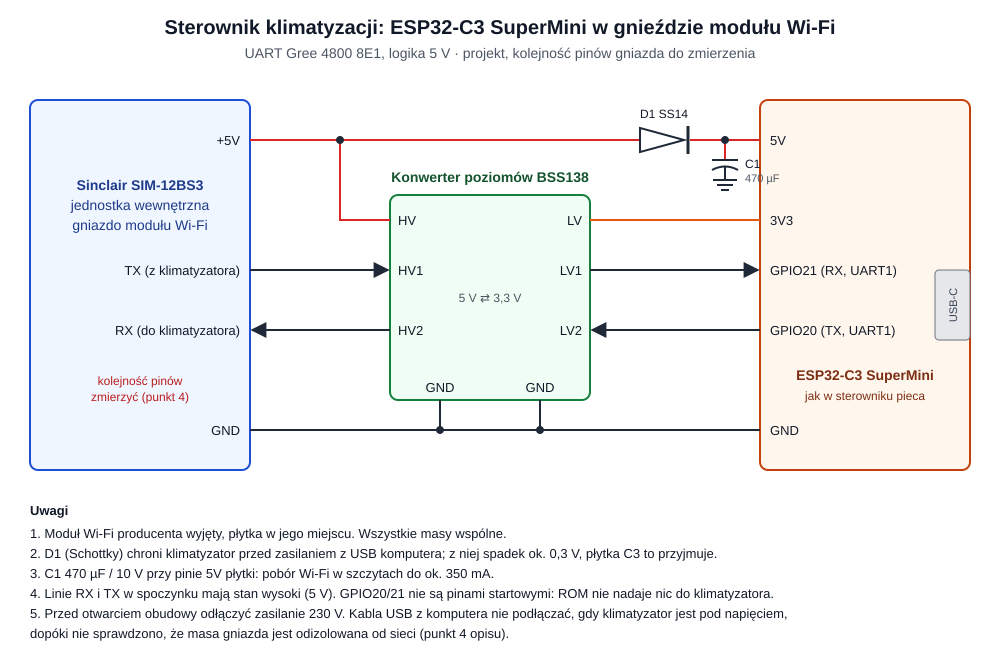
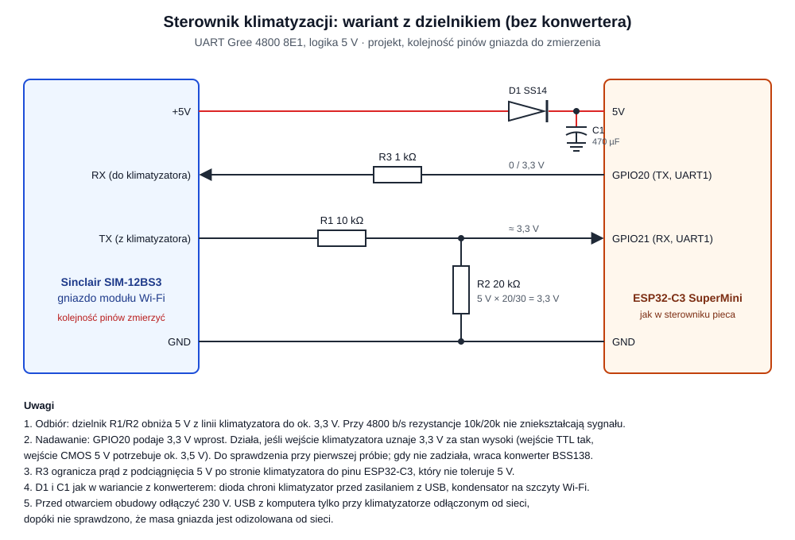

# Klimatyzator Sinclair SIM-12BS3: podłączenie sterownika

Projekt sterownika klimatyzatora ściennego **Sinclair SIM-12BS3** (3,2 kW chłodzenie,
3,6 kW grzanie, R32, produkcja 2024.10). Sinclair produkuje u Gree, więc sterownik
rozmawia z klimatyzatorem protokołem UART modułu Wi-Fi Gree. Płytka jest ta sama co
w sterowniku pieca: **ESP32-C3 SuperMini**, tylko zamiast modułu RS-485 HW-519 ma
konwerter poziomów 5 V ⇄ 3,3 V.

**Stan (2026-10-18):** tylko schemat. Nic nie zostało zmierzone ani podłączone.
Kolejność pinów gniazda, jego typ i wydajność zasilania 5 V nie są opisane w żadnym
znalezionym źródle i trzeba je zmierzyć (punkt 4). Urządzenie jest na gwarancji:
otwarcie jednostki i wyjęcie modułu producenta może ją naruszyć.

## 1. Zasada

Moduł Wi-Fi Gree jest osobną płytką wpiętą przewodem w gniazdo na płycie jednostki
wewnętrznej. Gniazdo daje zasilanie 5 V i łącze UART. Sterownik zajmuje miejsce modułu:
z gniazda bierze zasilanie, a przez UART czyta stan i wysyła polecenia. Pilot działa
dalej, bo klimatyzator odsyła w odpowiedzi swój bieżący stan.

```text
Sinclair (płyta jednostki wewnętrznej)
  └─ gniazdo modułu Wi-Fi: +5V, GND, TX, RX (UART 4800 8E1, 5 V)
       └─ konwerter BSS138 ─ ESP32-C3 SuperMini ─ Wi-Fi ─ chpc-web
```

## 2. Schemat



### Wariant bez konwertera: dzielnik



| Gniazdo modułu Wi-Fi | Przez | ESP32-C3 SuperMini | Uwagi |
|---|---|---|---|
| +5V | D1 | 5V | C1 470 µF między 5V a GND płytki, jak wyżej |
| TX klimatyzatora | R1 10 kΩ, węzeł, R2 20 kΩ do GND | GPIO21 (RX) | 5 V × 20/30 = 3,3 V |
| RX klimatyzatora | R3 1 kΩ | GPIO20 (TX) | stan wysoki tylko 3,3 V |
| GND | — | GND | masa wspólna |

Odbiór na dzielniku jest pewny. Nadawanie zależy od wejścia klimatyzatora: wejście TTL
przyjmuje 3,3 V jako stan wysoki, wejście CMOS 5 V potrzebuje ok. 3,5 V. R3 ogranicza
prąd, gdy linia ma po stronie klimatyzatora podciągnięcie do 5 V, bo piny ESP32-C3 nie
tolerują 5 V. Jeśli klimatyzator nie reaguje na polecenia, a odpowiedzi przychodzą,
nadawanie przechodzi na konwerter BSS138.

## 3. Części

| Oznaczenie | Część | Uwagi |
|---|---|---|
| — | ESP32-C3 SuperMini | jak w sterowniku pieca |
| — | konwerter poziomów BSS138, 4 kanały | popularny moduł „I2C level shifter”, wystarczą 2 kanały; przy 4800 b/s nie ma problemu z szybkością |
| D1 | dioda Schottky SS14 albo 1N5819 | zasilanie z gniazda na pin 5V płytki; blokuje zasilanie klimatyzatora z USB komputera |
| C1 | kondensator elektrolityczny 470 µF / 10 V | przy pinie 5V płytki, na szczyty poboru Wi-Fi |
| — | wtyk pasujący do gniazda modułu | typ do ustalenia po otwarciu; najprościej przewód z oryginalnego modułu |

## 4. Połączenia

| Gniazdo modułu Wi-Fi | Przez | ESP32-C3 SuperMini | Uwagi |
|---|---|---|---|
| +5V | D1 (anoda od gniazda) | 5V | C1 między 5V a GND płytki |
| +5V | — | — (HV konwertera) | strona 5 V konwertera, przed diodą |
| TX klimatyzatora | HV1 → LV1 | GPIO21 (RX, UART1) | tak samo jak odbiór w sterowniku pieca |
| RX klimatyzatora | LV2 → HV2 | GPIO20 (TX, UART1) | tak samo jak nadawanie w sterowniku pieca |
| — | LV konwertera | 3V3 | strona 3,3 V konwertera |
| GND | GND konwertera | GND | masa wspólna |

GPIO20 i GPIO21 to piny UART0 w ROM ESP32-C3. GPIO20 jest w ROM wejściem, więc podczas
startu płytka nic nie nadaje do klimatyzatora. Komunikaty startowe ROM idą na GPIO21,
który tu jest wejściem z klimatyzatora, więc nie trafiają na jego linię.

## 5. Pomiar gniazda przed podłączeniem

Kolejność pinów trzeba ustalić na tym egzemplarzu. Moduły Gree mają zwykle wtyk
czteropinowy, ale to niepotwierdzone dla tego modelu.

1. **Odłączyć zasilanie 230 V**, podnieść przedni panel jednostki i zdjąć osłonę
   skrzynki elektrycznej (po prawej stronie, za panelem). Według instrukcji modułu
   Sinclair SWM-04 moduł leży obok skrzynki elektrycznej, przykręcony wkrętami, a jego
   przewód idzie do płyty w skrzynce; dokładne miejsce zależy od modelu. Gdy modułu nie
   ma, na płycie szukać gniazda opisanego zwykle „WIFI” albo „COM”. Zrobić zdjęcie płyty
   i gniazda.
2. **Masa i izolacja.** Przy wyłączonym klimatyzatorze sprawdzić omomierzem, czy GND
   gniazda nie łączy się z przewodem N ani L zasilania. Dopóki to nie jest pewne,
   komputer przez USB podłącza się do płytki tylko przy klimatyzatorze odłączonym od
   sieci. Płytkę programuje się wtedy z USB, a D1 nie przepuszcza zasilania do
   klimatyzatora.
3. **Napięcia.** Po włączeniu zasilania zmierzyć względem GND: jeden pin ma 5 V stałe
   (zasilanie), linie danych w spoczynku mają stan wysoki, ok. 5 V, i chwilowo spadają
   przy transmisji.
4. **Kierunek linii.** Z modułem producenta wpiętym: na linii TX klimatyzatora
   odpowiedzi pojawiają się dopiero po zapytaniach modułu na drugiej linii. Najprościej
   sprawdzić to analizatorem stanów logicznych albo samym sterownikiem w trybie
   nasłuchu (punkt 6).
5. **Wydajność 5 V.** Oryginalny moduł też ma Wi-Fi, więc gniazdo powinno dać prąd
   rzędu kilkuset mA. Po podłączeniu płytki zmierzyć napięcie na pinie 5V przy pracy
   Wi-Fi. Gdy spada poniżej ok. 4,5 V, płytkę trzeba zasilić osobno, zostawiając
   wspólną masę.

## 6. Protokół (z inżynierii wstecznej, nie od producenta)

Źródła: opis protokołu [bekmansurov/gree-hvac-protocol](https://github.com/bekmansurov/gree-hvac-protocol)
i wątek [Open source Gree wifi module replacement](https://community.home-assistant.io/t/open-source-gree-wifi-module-replacement/896581),
w którym klimatyzatory Sinclair są wymienione wprost. Komponent ESPHome `sinclair_ac`
(piotrva/esphome_gree_ac) obsługuje tę rodzinę.

- **UART:** 4800 b/s, 8 bitów, parzystość parzysta, 1 bit stopu (8E1), logika 5 V.
- **Ramka:** `0x7E 0x7E`, długość, polecenie, dane, suma kontrolna. Suma to suma
  wszystkich bajtów bez dwóch bajtów nagłówka, modulo 256.
- **Kto zaczyna:** zawsze moduł. Po starcie wysyła ramkę powitalną, potem cyklicznie
  pakiet stanu i sterowania (moduł producenta co 300 ms; wystarcza rzadziej, nawet
  co 10 s). Klimatyzator odpowiada tylko na zapytania modułu.
- **Sterowanie:** jeden pakiet niesie cały żądany stan (zasilanie, tryb, temperatura,
  wentylator), więc zmiana to wysłanie pakietu z nowymi polami. Zgłaszano, że
  klimatyzator czasem odrzuca polecenie, więc sterownik musi porównać stan z odpowiedzi
  z żądanym i powtórzyć, tak jak `co` robi to z CHPC.

Opisy różnią się numeracją poleceń (opis z GitHub nazywa pakiety bajtem długości, autor
z wątku Home Assistant numerem polecenia z firmware modułu). Pierwszy etap firmware
powinien więc tylko podsłuchiwać oryginalny moduł i zapisywać ramki, jak nagrania
w sterowniku pieca. Do nasłuchu obie linie danych idą na dwa wejścia płytki przez
konwerter, a moduł producenta zostaje wpięty i zasilany z gniazda.
