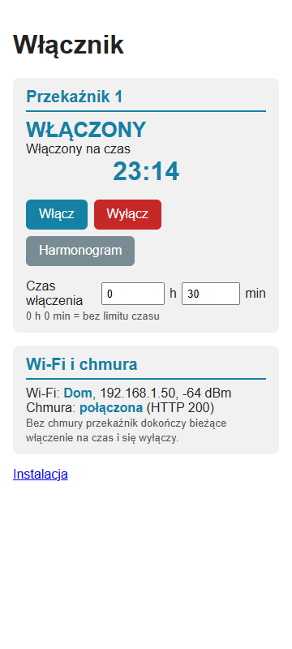
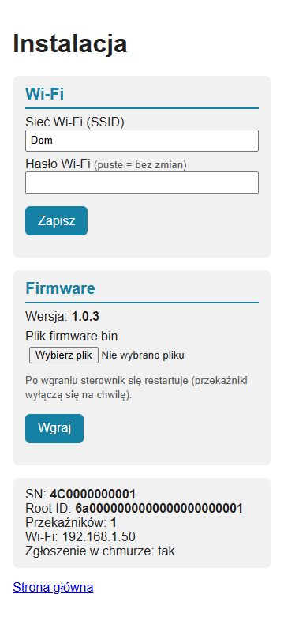

# Switch firmware — technical documentation

[← System documentation](../../../../docs/en/README.md) · [1. Business description](1-business-description.md) · [2. How it works](2-how-it-works.md) · **3. Technical documentation** · [Polski](../3-dokumentacja-techniczna.md)

The server side (API, collections, schedule, activation history) is described in the [switch module](../../../../docs/en/moduly/switch/3-technical-documentation.md).

## Hardware

| Element | Details |
|---|---|
| Board | ready-made **"ESP32 Relay AC X1"** module: ESP32-WROOM-32E N4 (4 MB flash, ESP32-D0WD-V3 chip), PlatformIO `esp32dev`; no USB |
| Power | built-in 230 V AC → 5 V supply (yellow transformer) and a 3.3 V regulator; 230 V input terminals |
| Relay | Songle SLA-05VDC-SL-A, 30 A / 250 V AC, normally open contact (NO); driven from **GPIO2**, high level = on; relay output terminals |
| P1 header | programming and console: `GND`, `RX`, `TX`, `3V3` (printed on the board); UART0, 115200 |
| Buttons | the button next to LED D6 = **IO0** (BOOT, programming mode); **no RST button** |

**Relay pin.** The pin test of 2026-10-02 pointed to GPIO17 or GPIO2 (message delay made it impossible to tell). On GPIO17 the relay did not click; on GPIO2 it works (2026-10-03). Firmware 1.0.2 drove both pins at once, 1.0.3 only GPIO2. GPIO2 is an ESP32 strapping pin: the firmware makes it an output only in `setup()`, after the chip has started, setting the "off" level first.

## Wiring: programming

The board has no USB, so the first firmware is flashed through the P1 header and a USB-TTL adapter. An FT232RL was used (FTDI driver from Windows), because the CP210x driver is blocked on the laptop with code integrity policy (HVCI).

```text
  FT232RL adapter                          board P1 header
  (3.3 V logic levels)                     (printed: GND, RX, TX, 3V3)

        GND ──────────────────────────────── GND
        TX  ───────────────────────────────► RX    (UART0, GPIO3)
        RX  ◄─────────────────────────────── TX    (UART0, GPIO1)
        VCC   ✗ do not connect               3V3 ── only from a separate 3.3 V supply (option A)
```

**The header's 3V3 pin is 3.3 V, not 5 V** — applying 5 V may damage the ESP32. **The 3.3 V output of the FT232RL adapter is not enough** (about 50 mA; the ESP32 did not respond). Two tested options:

| Option | Board power | Notes |
|---|---|---|
| **A (recommended)** | separate 3.3 V supply (e.g. an AMS1117 module) on the `3V3` pin, `GND` shared with the adapter; 230 V not connected | no mains voltage on the board |
| **B** | board powered from 230 V, only `GND`, `TX`, `RX` connected to the adapter | **connects the laptop to a mains-powered board**; safe only if the board's supply is isolated. Laptop on battery (no charger), nothing on the relay output, do not touch the board (230 V traces on the underside) |

With the adapter connected, "Brownout detected" and a start in programming mode were observed — disconnect the adapter after flashing and testing.

## Wiring: installation

```text
            230 V mains through protection chosen by an electrician
              L ──┬──────────────────────────────────────┐
              N ──┼──────────────┐                       │
                  │              │                       │
          ┌───────┴──────────────┴───────┐        ┌──────┴───────┐
          │ 230 V input terminals (L, N) │        │ COM          │
          │ supply 230 V → 5 V → 3.3 V   │        │  relay       │
          │ ESP32 ── GPIO2 ──────────────┼───────►│  30 A        │
          └──────────────────────────────┘        │ NO ──┐       │
                                                  └──────┼───────┘
                                                    ┌────┴─────┐
              N ────────────────────────────────────┤  load    │
              PE ───────────────────────────────────┤ (heater) │
                                                    └──────────┘
```

- **The NO contact in the load's phase conductor**: the relay closes `COM`–`NO` when GPIO2 is high. Without power the load is off, and after start the firmware keeps the relay off until the cloud sends a command. The diagram assumes a potential-free contact on the output terminals; check the terminal markings and whether the board connects `COM` to `L` before installation.
- **Large loads** (water heater): the relay is rated 30 A / 250 V AC, but the wire cross-section, terminals, protection and a possible contactor (inductive load, current close to the limit) are chosen by an electrician. The heater's thermostat stays in the circuit.
- The load's **PE** is connected directly, not through the board.
- Installation only by a person qualified for 230 V work, in an insulating enclosure; the board has exposed 230 V traces.

## Files (`devices/switch`)

| File | Role |
|---|---|
| `platformio.ini` | environments `esp32dev` (production), `esp32dev-local` (local server), `native` (tests) |
| `src/switch.cpp` | `setup()` (relays off, NVS, network), `loop()`/`tick()`, registration, state exchange, local changes to the cloud, WebSocket, AP, OTA, web pages, console log |
| `src/firmware.hpp` | `DEVICE_TYPE`, `FW_VERSION`, `DEVICE_NAME`, `RELAY_PINS`, `RELAY_ACTIVE_HIGH`, `DEFAULT_ON_MINUTES`, `MAX_ON_MINUTES`, `CLOUD_URL` (from the `SWITCH_CLOUD_URL` macro) |
| `src/relays.*` | `RelayBank`: `applyCloud` (cloud command, ignored while `pending`), `applyLocal` (change from the page), `update` (end of countdown), `pendingMinutes`, `confirmPending` (by change number) |
| `src/protocol.*` | `buildStateReport`, `applyStateResponse`, `buildModeBody`, `parseDefaultMinutes` |
| `src/ota.*` | `parseOtaOffer` (`{version, url, sha256, request}`), `otaKey` (`version#request`), `shouldUpdate` (one attempt per request) |
| `src/secrets.example.h` | template of `secrets.h` (outside git): `AP_SSID` ("Wlacznik-setup"), `AP_PASSWORD` (empty = open AP), `INSTALL_USER`, `INSTALL_PASSWORD`, `WIFI_SSID`, `WIFI_PASSWORD` |
| `test/test_logic/test_main.cpp` | 12 `native` tests |

## Constants

| Constant | Value | Location |
|---|---|---|
| `DEVICE_TYPE` / `DEVICE_NAME` | `switch` / "Włącznik" | `firmware.hpp` |
| `FW_VERSION` | `1.3.4` | `firmware.hpp` |
| `RELAY_PINS` / `RELAY_ACTIVE_HIGH` | `{2}` / `true` | `firmware.hpp` |
| `DEFAULT_ON_MINUTES` / `MAX_ON_MINUTES` | 30 / 10080 | `firmware.hpp` |
| `CLOUD_URL` | `https://chpc-web.onrender.com/api/` (`esp32dev-local`: `http://192.168.55.9:4001/api/`) | `firmware.hpp`, `platformio.ini` |
| `MAX_RELAYS` | 8 | `relays.hpp` |
| `EXCHANGE_INTERVAL_MS` | 5 s | `switch.cpp` |
| `REGISTER_RETRY_MS` / `PENDING_RETRY_MS` | 30 s / 5 s | `switch.cpp` |
| `CLOUD_ONLINE_MS` | 30 s (cloud "available" after a successful exchange) | `switch.cpp` |
| `AP_OFF_AFTER_MS` / `AP_ON_AFTER_MS` | 1 min / 1 min | `switch.cpp` |
| `HTTP_TIMEOUT_MS` / `REGISTER_TIMEOUT_MS` / `OTA_TIMEOUT_MS` | 4 s / 8 s / 15 s | `switch.cpp` |
| `STATUS_LOG_MS` | 30 s | `switch.cpp` |
| `AP_ADDRESS` | `10.11.17.1` | `switch.cpp` |

## NVS (namespace `sw`)

| Key | Content |
|---|---|
| `wifi_ssid`, `wifi_pass` | Wi-Fi from `/install` (empty = values from `secrets.h`) |
| `root_id` | Root ID from the registration reply (cleared on 404/409) |
| `def_min` | default "Turn on" time on the controller page, from the cloud [min] |
| `ota_tried` | the offer key `version#request` (`otaKey()`) after whose download the controller last restarted (one attempt per request, protection against an update loop; up to 1.0.3 the version alone) |

The relay state is not stored: after start the relays are off and the cloud restores the state.

## Contract with the cloud

| Request | Body | Reply |
|---|---|---|
| `POST devices/register` | `{deviceId: SN, deviceType: "switch", name: "Włącznik", version, ip, relays}` | `{rootId, settings: {default_on_minutes, firmware?: {version, url, sha256, request}}}`; `firmware` only with an "Aktualizuj" request |
| `POST switch/state?deviceId=&rootId=` | `{uptimeS, relays: [{on, changedS}]}` | `{relays: [{on, offAfterS?, mode}], firmware?}` (`firmware` as above, read from 1.1.0); 404 unknown SN, 409 foreign Root ID |
| `PUT switch/mode?deviceId=&rootId=` | `{relay, mode, minutes?, source: "controller"}` (`minutes` only for `timer`) | the relay; 400 change not acceptable (not retried) |
| WebSocket `/ws?rootId=` | — | `{"type":"operation"}` → immediate state report; other messages ignored |

SN = the factory MAC from eFuse, 12 hex characters. `rootId` is appended when stored; the server also finds the controller by the SN alone. The server certificate is not verified (as in `co` and the tank controller). The WebSocket host, port and TLS are derived from `CLOUD_URL`.

## Web pages (port 80)

| Address | Access | Content |
|---|---|---|
| `GET /` | open | main page; JS fetches `/state.json` every 1 s (no refresh while the cursor is in a field); a card per relay ("Relay N"): state ("ON" / "OFF"), mode ("mode unknown (no cloud)" before the first reply, "waiting to be sent to the cloud" while `pending`), countdown `h:mm:ss`, the buttons "Turn on", "Turn off", "Schedule" (disabled in schedule mode), the fields "On time [h] [min]"; the "Wi-Fi and cloud" card |
| `GET /state.json` | open | `relays[]` (`relay`, `on`, `mode`, `remainingS`, `pending`), `defaultMinutes`, `wifi`, `ssid`, `ip`, `rssi`, `cloud`, `lastStatus` |
| `POST /relay?n=&mode=on\|off\|timer\|schedule&minutes=` | open | change from the page; `minutes` 1–10080 only for `timer`; 400 bad number, mode or time |
| `GET`/`POST /install` | Basic Auth | the "Setup" page: Wi-Fi (empty password = unchanged; saving connects at once, without a restart), firmware version and OTA state, SN, Root ID, number of relays, IP address, registration state, the "Mail" card with the mail key fingerprint |
| `POST /install/firmware` | Basic Auth | manual upload of `firmware.bin` (multipart, field `firmware`); restart after upload (relays briefly off); 409 for an invalid file |

An unknown address shows the main page. The `/install` login and password are in `secrets.h`. From version 1.3.5 the pages are in English (`lang="en"`, no language selection); the screenshots below show the Polish pages from before that version. The mail status text below the key fingerprint comes from the shared library `devices/common/mail_relay` and is still in Polish.

| Main page | Installation |
|---|---|
|  |  |

## First flashing through the P1 header

1. Build the image: `pio run -d devices/switch` (files in `devices/switch/.pio/build/esp32dev/`).
2. Connect the adapter as in the [programming diagram](#wiring-programming), board not powered yet.
3. **Programming mode:** hold the IO0 button (next to LED D6), apply power (option A or B), release the button.
4. Flash everything at 115200 baud:

```bash
esptool.py --chip esp32 --port COMx --baud 115200 --before no_reset --after no_reset \
  write_flash -z 0x1000 bootloader.bin 0x8000 partitions.bin 0xe000 boot_app0.bin 0x10000 firmware.bin
```

   `boot_app0.bin` is in `framework-arduinoespressif32/tools/partitions/` (PlatformIO package), the other files in `.pio/build/esp32dev/`.
5. Disconnect power and the adapter, power the board normally. Connect a phone to `Wlacznik-setup` and set the Wi-Fi on `http://10.11.17.1/install`.

**Further versions over Wi-Fi:**

```bash
curl -u <login>:<password from secrets.h> -F "firmware=@.pio/build/esp32dev/firmware.bin" http://<controller IP>/install/firmware
```

or the "Firmware" form on the `/install` page, or "Aktualizuj" (update) in the application (OTA, below).

## Over-the-air update (OTA)

The flash layout is the default Arduino-ESP32 table with two application partitions (`app0`/`app1`, 1.28 MB each; the image takes about 77 %).

1. The `.bin` file is in the server database (`firmware_images`, `firmware_offers`; the offered version and one previous). **The server does not send the offer by itself:** only when the device has a request `devices.firmwareUpdate {version, requestedAt}`, created by the "Aktualizuj" (update) button in Settings ("Sterownik" card, `POST /api/devices/:rootId/firmware-update`) and cancelled by "Anuluj aktualizację" (`DELETE`). With updates disabled on the firmware page, requests are not delivered. The request disappears by itself when the controller registers with the offered version.
2. The offer `{version, url, sha256, request}` (`url` = `<server>/api/firmware/switch/<version>.bin`, `request` = `requestedAt` in ms as a string) is in the registration reply (`settings.firmware`) and in every `POST switch/state` reply (`firmware`). Version 1.0.3 reads it only at registration (a restart is needed); from 1.1.0 also from the state exchange, so the update starts within seconds.
3. The controller accepts the offer when the address starts with `https://`, the version is non-empty and `sha256` has 64 hex characters.
4. The download starts when: the registration succeeded, the last state exchange succeeded within 30 s, **all relays are off**, there are no unsent local changes, the offered version differs from `FW_VERSION`, and the key `version#request` (`otaKey()`) differs from `ota_tried` and from the key tried in this start (RAM). While a relay is on, the controller waits for it to switch off.
5. The image goes straight into the inactive partition with SHA-256 computed on the fly; it is activated only if the checksum matches. Then the key is stored in `ota_tried` and the controller restarts; the cloud restores the relay state. Each "Aktualizuj" gives one attempt; a failed one is retried by clicking again (a new request). The attempt state is shown on `/install` ("Cloud update: …", e.g. "downloading version 1.3.5", "SHA-256 checksum mismatch").

**Weather (from 1.1.3, many places from 1.2.0; shared with `co` in `devices/common/weather/src/weather.hpp` from 1.3.1).** The cloud returns in the state reply `weather_query {lat, lon}` (home) and `weather_queries [{id, lat, lon}, …]` (weather tiles, at most 8). The controller fetches each place from Open-Meteo (every 15 min, one request at a time 5 s apart, retry after 5 min on error) and sends `weather` in the next state report: `[{id, temp, code, cloud, precip, rain, snow, wind, day, age_s}]`. Readings older than 45 min are not sent. From 1.3.3 the request selects the **DWD ICON** model (`models=icon_seamless`, about 2 km over Central Europe) instead of Open-Meteo's automatic choice: on 2026-10-18 the default model reported "overcast" in sunshine (98 % cloud cover from thin high clouds only), ICON reported "partly cloudy" (42 %), matching PV production. The response format is the same. From 1.3.4 (2026-10-19) weather is fetched over **plain HTTP** instead of HTTPS: after a day of uptime there was no contiguous memory for another TLS connection next to the cloud, the WebSocket and the mail relay (diagnostics: largest heap block 45 KB, mbedtls `-0x7F00` SSL_ALLOC_FAILED, 808 failed fetches out of 1072). Weather data is not confidential and the certificate was never checked anyway.

**Diagnostics in the state report (`diag`, from 1.1.2; memory and weather from 1.3.2).** Each report carries `diag {reset, boot, wifiDrops, rssi, httpMs, heapFree, heapMin, heapBlock, weather}`: reset reason and boot number, Wi-Fi drops, signal strength, duration of the previous exchange, heap in bytes (free, lowest since boot, largest contiguous block — a TLS connection needs about 16 KB contiguous) and `weather {places, ok, fail, code, tls, heapBlock, agoS}`: places from the cloud, successful and failed fetches since boot, result of the last attempt (HTTP code; negative = HTTPClient connection error; 1 = unreadable 200 reply), mbedtls error (meaningful only for a failed attempt), largest heap block just before the attempt and seconds since it. The server keeps the last diagnostics in memory (`GET /api/switch/diagnostics`) and logs each new boot in the operation log.

**Releasing a new version:** raise `FW_VERSION` in `src/firmware.hpp`, `pio run -d devices/switch`, upload `.pio/build/esp32dev/firmware.bin` on the firmware page in the application (controller list → cog on the switch tile, plus on the "Aktualna wersja" bar, version equal to `FW_VERSION` and a description) or `curl -X PUT -H "Content-Type: application/octet-stream" --data-binary @firmware.bin "https://chpc-web.onrender.com/api/firmware/switch/<version>?description=<text>"`. Then click "Aktualizuj" in the switch Settings; the controller downloads the image once the relay is off.

## Build, tests, environments

```bash
cp devices/switch/src/secrets.example.h devices/switch/src/secrets.h   # once, fill in
pio test -d devices/switch -e native            # 12 tests
pio run  -d devices/switch                      # esp32dev build (flash about 77 %, RAM about 15 %)
pio run  -d devices/switch -e esp32dev-local    # build for a test with npm run local
pio device monitor -d devices/switch            # console 115200 through the P1 header
```

**`esp32dev-local`** replaces `SWITCH_CLOUD_URL` with `http://192.168.55.9:4001/api/` — the address of the computer running `npm run local`, to be changed in `platformio.ini`. The Windows firewall blocks port 4001 in the public network profile (switch the profile to private or add a rule). An image from this environment does not connect to production, and the local OTA offer has an `http://` address, so the controller ignores it (upload through `/install`).

**Console log.** Lines `[ms since start] text` on UART0 115200 (P1 header): start (version, SN, Root ID, number of relays, cloud address), AP, Wi-Fi, registration with the reply and the OTA offer, every relay change with its cause (cloud, controller page, end of time), local changes sent to the cloud, HTTP errors, OTA steps. Every 30 s a `stan:` line (Wi-Fi with RSSI, registration, cloud, last HTTP, AP, relay 1). A 2 KB transmit buffer keeps the log from delaying the loop.

**`native` tests** (`test/test_logic`): a timed on command from the cloud switches off by itself; a refreshed command extends the countdown without a state change; on without a limit; a local change wins over the cloud until confirmed (including the change number); a local timer and the minutes to send; a local "Schedule" switches off only without the cloud; state report JSON; applying the reply; `PUT switch/mode` JSON; default time from `settings`; OTA offer; one attempt per request (`version#request`). **Wi-Fi, HTTP, WebSocket and the pages have no automatic tests** — without a board use the server-side simulator: `node scripts/simulate-switch.mjs [--relays N] [--history]` with `npm run local`.

## Known issues and notes

- **Security:** the AP is open by default after start, the pages are plain HTTP, `/` and `POST /relay` have no login — within AP range (the first minute after connecting to Wi-Fi or after a Wi-Fi loss) and in the home network anyone can switch the relay.
- **Registration only at start** (and after 404/409), not after an IP address change as in `co`: the IP address in the application and the default time on the controller page are refreshed at restart (from 1.1.0 the OTA offer also comes with the state exchange). The board has no RST button; a restart = disconnecting power or uploading firmware on `/install`.
- **Uploading on `/install` does not wait for the relay to switch off** (unlike OTA from the cloud): the restart switches it off for a few to a dozen or so seconds.
- **The controller page does not know the relay names** from the application — it shows "Relay N".
- **GPIO17** from the pin test does not drive the relay on this board; do not go back to it without a measurement.
- **The OTA download and the pages have no tests on the board** beyond manual checks; the certificate is not verified, and image integrity relies on the SHA-256 from the cloud reply (same channel).
