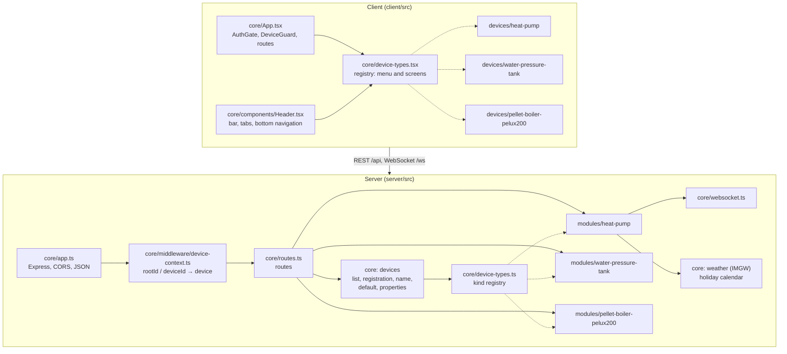
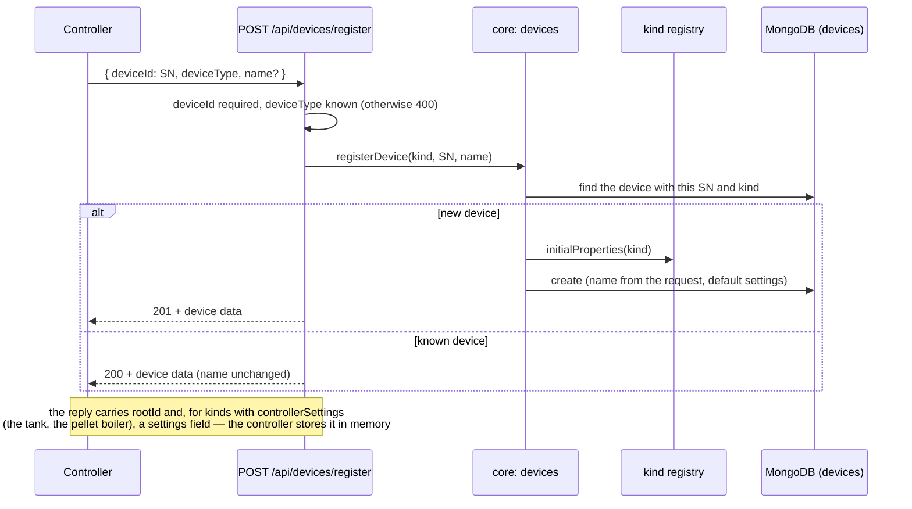
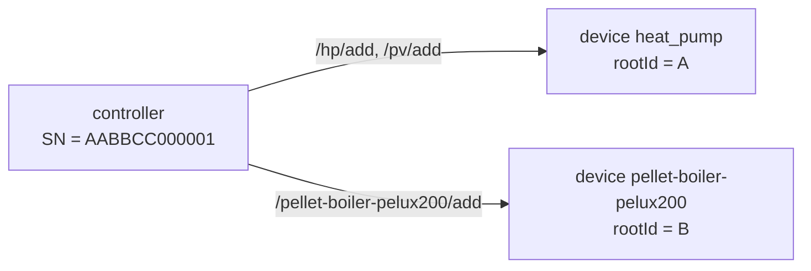
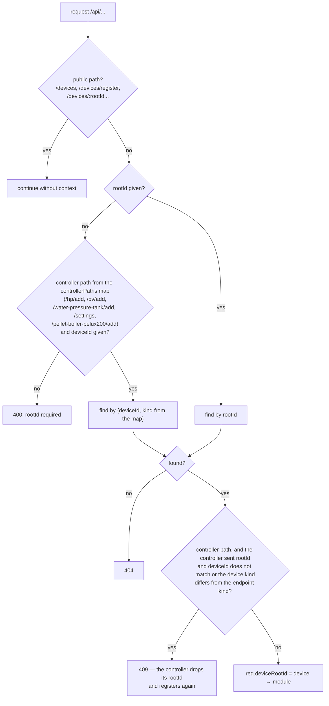
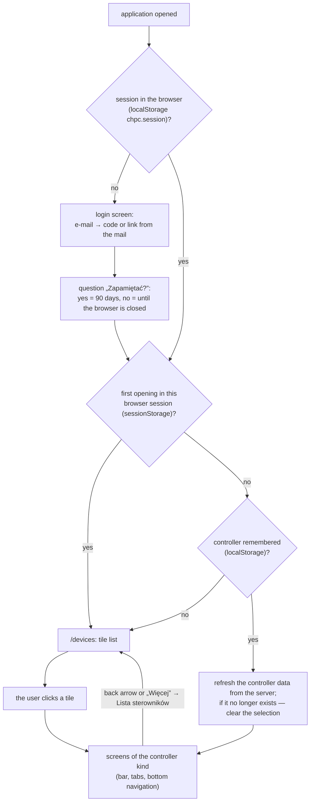
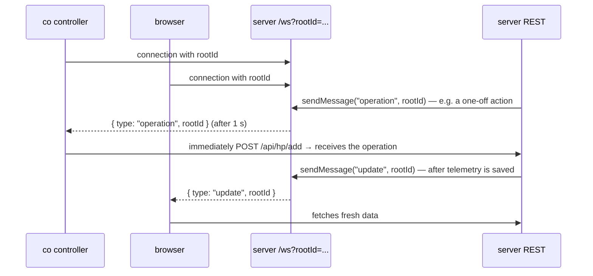

# Core module — how it works

[← System documentation](../../README.md) · [1. Business description](1-business-description.md) · **2. How it works** · [3. Technical documentation](3-technical-documentation.md) · [Polski](../../../moduly/core/2-zasada-dzialania.md)

## Place in the system

Core joins the controller-kind modules into one application. On the server it accepts every request, works out which controller it concerns and hands it to the module. On the client it keeps track of the selected controller and builds the menu from the module descriptions.

The controller-kind modules do not know about each other. Only core connects them: routes, the registry and the shared device document in the database.

## Controller registration

The tank controller registers at every start (it receives its settings in the reply); `co` registers at every start, after every IP address change and after a 409 reply, even when it already has the Root ID of the given role (a different `rootId` in the reply replaces the stored one); the boiler controller registers at every start. The tank controller, `co` and the boiler controller send their IP address in the registration and the client shows it in Settings. The server recognises a device by the pair (kind, SN): a new one is created, a known one gets its record back.

The controller stores `rootId` in its memory (NVS; a controller with several roles separately for each role). It may send data before registering too, with the SN only — the server accepts it if a device with that SN and the endpoint's kind already exists.

## One controller, several roles

A physical controller may have several devices in the application. That was the case on 2026-10-01–02: `co` was the heat pump (`heat_pump`) and the pellet boiler (`pellet-boiler-pelux200`); since 2026-10-03 the boiler has its own boiler controller (`devices/pellet-boiler-pelux200`), and the role mechanism stays in the server. They share the `deviceId` (SN) but have a different `deviceType` and a different `rootId`; the `devices` model has no unique index on `deviceId`. So there is no "parent device": each role is an ordinary device with its own context, menu, data and settings.

Since the SN alone does not identify a device, the server picks the role by the **endpoint path** (the `controllerPaths` map in `device-context.ts`, below) and looks up the pair `{deviceId, deviceType}`. Registration (`POST /devices/register`) uses that pair too, so the same SN registered with a different kind creates a second device.

## Device context of every request

Almost every `/api` request has to point at a controller. The `device-context` middleware does it before the request reaches a module.

The 409 reply protects against a controller holding a `rootId` from a different database (e.g. after switching the server from local to production) or from another role (e.g. a pump `rootId` sent to the boiler endpoint).

For ordinary endpoints (outside `controllerPaths`) the context is determined by `rootId` alone, with no device kind check.

## Choosing a controller in the application

- Without a session every path shows the login screen (`AuthGate`); the link from the mail leads to `/login?token=…`. A new account must first fill in the first name, last name and country. A "remembered" session lasts 90 days from login, an unremembered one 24 h from last use (it disappears when the browser is closed).
- A new browser session always starts from the tile list (`sessionStorage` `chpc.startedOnList`); there is no default controller and no automatic choice.
- The selected controller is kept in `localStorage` (`chpc.selectedDevice`), so a page reload stays on its screens. A remembered controller that no longer exists in the database (e.g. after switching from the local to the production database) is removed from browser memory. A network error removes nothing.
- A controller shared by another account has a "Udostępnione przez …" (shared by) banner above the content and only the shared tabs in the menu. A "Panel prosty" share (`tabs: ['simple']`) gives no tab: the person sees only the simple tile on the list (switch: on / off / schedule, boiler: turn on / off / DHW) and may only send those commands (`PUT /switch/mode`, `POST /pellet-boiler-pelux200/simple`). The owner turns the simple tile on for their own list with the toggle in the "Dane sterownika" dialog (`users.simpleTiles`).

## Menu and screens from the registry

Each controller kind lists its screens (path, label, icon, page) in its `device-type` file. The application:

1. creates routes for all paths of all kinds;
2. for the requested path shows the screen of the active controller's kind;
3. if that kind has no such path (e.g. the tank and `/schedules`), redirects to the home page;
4. draws the tabs in the bar from the screens of the active kind: on a computer (from 900 px) as a side menu on the left, on a phone as the bottom navigation with the first four views and "Więcej" (a sheet with the remaining views and "Lista sterowników").

After a controller change the screen is created from scratch, so no data of the previous controller is left in it. The "Operacje" tab (operations log) is shared and a kind only adds it to its list; pages outside the controller context (`/devices`, `/account`, `/firmware/:deviceType`) have their own bar without tabs.

The "Instrument" look (mock-ups in `makiety/`, 2026-10-16): all screens are built from the same elements — a card with a header, a "hero" card with a big value and KPI fields on the overview, a filter bar (date navigation ‹ ›, a segmented switch, a CSV button) above a table or chart, stat tiles, a list of schedule entries with a "działa teraz" (active now) marker, two columns in Settings (the form on the left, the "Sterownik" and "Udostępnianie" cards on the right), `.modal` dialogs. Colours come only from the theme tokens (`theme.css`), so the same layout works in the light and the dark theme.

The server has a matching registry: each kind provides the settings of a new device and the settings returned on registration (tank: compressor time; pellet boiler: `poll_interval_seconds`).

## WebSocket

The WebSocket carries nothing but a "come and get the data" signal. Operations always reach the controller in the reply to its own HTTP request. A connection without `rootId` is closed by the server.

## Shared services

- **Outdoor temperature.** At start and every 10 minutes the server fetches the reading of the IMGW synoptic station (Zakopane). The value is added to heat pump telemetry records (`t_out`) and sent back to the `co` controller, which shows it on its display.
- **Calendar.** All user dates are in the `Europe/Warsaw` time zone. The calendar knows fixed and movable Polish holidays (Christmas Eve included) and decides whether a day is a working day — the heat pump schedule uses it.
- **Weather.** The server does not query Open-Meteo itself (Render shares its IP address with other services and the requests were rejected). In the reply to every state report the switch receives a list of places (`weather_queries`: the home and the weather tiles of all accounts, at most 8), fetches the conditions every 15 min per place and sends them back in the next report; the server keeps them in memory by tile id (`meteo.service`) and ignores readings older than 45 min. `GET /temperature` returns the home temperature (the boiler's outdoor sensor up to 15 min after the reading, otherwise the forecast) and the home weather — used by the strip above the list, the "Dom" tile, an account's tile within 3 km of home (`nearHome`; only the system user sees "Dom") and the "Teraz" header of the weather page (since 2026-10-21), because the 2 km model was off by 3–4 °C at night; `GET /weather-tiles` the tiles with weather. The forecast on the weather page is fetched by the browser directly from Open-Meteo.
- **Mail through the controllers** (`MAIL_RELAY=1`). `sendMail` composes the MIME message, puts it in the `mail_outbox` queue and wakes the controllers with the WebSocket message `{type:"mail"}`. The switch sends; `co` takes the mail over when the switch did not pick it up within 20 s, reported an error or did not answer within 60 s; at most 3 attempts, a mail is valid 15 min. The board has its own P-256 key pair (public key in the registration, `mailKey`); the SMTP credentials and every mail are encrypted with its key (ECDH + AES-256-GCM) and kept only in the board's memory. A new key waits for approval in the application (the "Sterownik" card, "Poczta" row, system user). Without a controller asking for mail in the last 150 s, login, e-mail change and account deletion get 503 before a code is even created.

- **Web Push notifications** (`push.service.ts`, the `web-push` library, VAPID keys in the environment). The browser registers the service worker `sw.js` and a PushManager subscription (`POST /push/subscriptions`); the account rules (`users.notifications`: events per controller, quiet hours) are saved by `PUT /push/rules`. Modules report events with `notify(rootId, event, {body, url})` where they store the controller state: a change of `HPS` and a new `error_code` of the pump, a relay state change, a flame state and an alarm of the boiler, a new water pump run; offline / online is computed by a watchdog every minute from the tile chip (`push-watchdog.service.ts`, the first run only records). The recipient must have a rule and still have access to the controller; the same event at most once per 60 s per person; during quiet hours only urgent events. A subscription rejected by the push service (404 / 410) is deleted. `notify` never throws.
- **Demo mode** (`DEMO_OWNER_EMAIL`). `POST /auth/demo` creates a session on the owner's document with `demo: true` (2 h, not extended, at most 10 entries per address per 10 min); `sessionFromToken` adds the in-memory `isDemo` flag. Access: the `demo` role to the owner's controllers, no management. `authorize` rejects every method except GET (403 `{demo: true}`), including `/auth/*` except logout. The `scrubDemo` safety net removes from every JSON response the keys `deviceId` (SN = board MAC, enough for controller commands), `ipAddress`, `mailKey`, `email`, address and `location`; `publicUser` returns a "Demo" profile, the device list shows the owner as "Właściciel", weather tiles have coordinates rounded to 0.05°, the operations log shows "Użytkownik". With `user.isDemo` the client shows the bar, stops writes already in `http.ts` (with a message) and hides pencils, sharing, SN, Root ID and notifications.
- **Language (pl / en).** The client has its own dictionary (`core/i18n/`: `pl.ts` and `en.ts` with the same keys; `t`, `tn` for plurals, `useLang`). Without a choice the browser language applies with Polish as the fallback; the choice from the login bar or the account menu goes to `localStorage` `chpc.lang`, and for a signed-in user to `users.language` (`PUT /auth/me/language`), from where it applies on every device (the account language wins over the browser; an account without a language gets the current one). Every request carries an `Accept-Language` header, and the server (`core/i18n.ts`, `requestLang`: header → account language → pl) answers in that language wherever it builds text itself: the tiles of `GET /devices/summary` (the Online / Offline chips stay identifiers, the client translates them), login, notification and mail error messages, mails (the recipient's account language, otherwise the request language; the mail to the administrator is Polish) and push notifications (the body in both languages, a separate payload for each recipients' language). Texts stored in the database stay Polish: request reasons and the operations log, boiler parameter ratings, technical device validation messages.
- **PWA and Android.** A manifest with PNG icons (192, 512, maskable) and the service worker `public/sw.js`: at install it stores the shell (`index.html`, manifest, icons, the `/assets/` files read from `index.html`), navigations network-first (5 s), then cache, finally the built-in "Brak połączenia" page; `/api/` and `/ws` are never cached; matching with `ignoreVary` (Render sends `Vary: Origin`). Registered by `index.tsx` only in the production build. The Android package is a TWA made with Bubblewrap (`android/`, README there): `twa-manifest.json`, the signing key outside git, `build.ps1` builds and signs the `.apk` and `.aab`; `client/public/.well-known/assetlinks.json` with the key fingerprint removes the address bar.

## Server start

1. Environment variables are loaded; without `MONGODB_URI` the server stops with an error.
2. MongoDB connection.
3. The heat pump scheduler starts (one run immediately, then every minute).
4. PV panel details older than 90 days are cleaned (immediately and every 24 h).
5. The IMGW temperature is fetched and then refreshed every 10 minutes.
6. HTTP and WebSocket listen on `PORT`.
