# Moduł core — opis biznesowy

[← Dokumentacja systemu](../../README.md) · **1. Opis biznesowy** · [2. Zasada działania](2-zasada-dzialania.md) · [3. Dokumentacja techniczna](3-dokumentacja-techniczna.md) · [English](../../en/moduly/core/1-business-description.md)

## Po co jest ten moduł

Core to część wspólna aplikacji chpc-web, niezależna od rodzaju urządzenia. Dzięki niej w jednej aplikacji można mieć kilka sterowników różnych rodzajów (dziś pompę ciepła, fotowoltaikę, hydrofor, włącznik i kocioł pelletowy), przełączać się między nimi i dodawać nowe rodzaje bez przebudowy całości.

Moduł odpowiada za:

- **listę sterowników** (kafelki) i wybór tego, z którym użytkownik pracuje;
- **samodzielne zgłaszanie się sterowników**: nowy sterownik po podłączeniu do internetu sam pojawia się w aplikacji, nie trzeba go nigdzie wpisywać;
- **nazwy sterowników**, układ kafelków i kafelki pogody;
- **konta użytkowników**: logowanie e-mailem i kodem, dane konta, udostępnianie sterownika innej osobie z wyborem zakładek;
- **wspólny wygląd**: pasek sterownika z zakładkami, dolną nawigację na telefonie, motyw jasny i ciemny, okna dialogowe, kartę „Sterownik” i dziennik operacji;
- **menu i ekrany zależne od rodzaju sterownika** (pompa ma harmonogramy, hydrofor i fotowoltaika nie);
- **wspólne usługi**: temperaturę zewnętrzną (IMGW), pogodę domu i miejscowości z kafelków (Open-Meteo, pobierana przez włącznik), stronę pogody z prognozą, kalendarz polskich świąt, szybkie powiadamianie sterownika i przeglądarki (WebSocket);
- **pocztę**: kody logowania i powiadomienia wysyłają sterowniki w domu (włącznik, zapasowo `co`), bo serwer na darmowym planie Render nie może łączyć się z pocztą.

## Dla kogo

- **Właściciel instalacji** — loguje się, wybiera sterownik, nadaje mu nazwę, układa kafelki, udostępnia sterownik domownikom. Korzysta z aplikacji na komputerze i na telefonie.
- **Instalator** (zwykle ta sama osoba) — podłącza nowy sterownik; wystarczy, że sterownik ma Wi-Fi, reszta dzieje się sama.
- **Użytkownik systemowy** — konto administracyjne (logowanie „system” i hasło): widzi wszystkie sterowniki, zarządza firmware rodzajów sterowników i widzi zajętość bazy.

## Co użytkownik może zrobić

| Czynność | Gdzie |
|---|---|
| Zalogować się | ekran logowania: e-mail → kod z maila (albo link z maila); po zalogowaniu pytanie „Zapamiętać?” — sesja zapamiętana trwa 90 dni. Mail wysyła sterownik w domu; gdy żaden nie jest w sieci, ekran pokazuje „Poczta jest chwilowo niedostępna…” |
| Zobaczyć pogodę i prognozę dla miejscowości | kliknięcie kafelka pogody → strona pogody z zakładkami Teraz, Najbliższe dni, Słońce i PV, Ogrzewanie, Powietrze, Wiatr i opady; kafelek „Moja lokalizacja” bierze położenie z przeglądarki |
| Zobaczyć wszystkie sterowniki i wybrać jeden | lista kafelków „Sterowniki” (`/devices`); aplikacja zawsze zaczyna od niej |
| Nadać lub zmienić nazwę sterownika | ołówek na kafelku (po najechaniu) albo ołówek w karcie „Sterownik” w Ustawieniach |
| Ułożyć kafelki, ukryć kafelek, dodać kafelek pogody dla dowolnej miejscowości | ikona siatki w pasku → tryb „Zmień układ”: strzałki (przeniesienie, zamiana), oko (ukrycie), „+ kafelek pogody” w pustym polu, „Gotowe” |
| Przełączyć się na inny sterownik | strzałka wstecz w pasku (do listy) albo na telefonie „Więcej” → „Lista sterowników” |
| Zobaczyć Root ID, SN, adres IP i firmware sterownika | okno „Dane sterownika” i karta „Sterownik” w Ustawieniach |
| Udostępnić sterownik innej osobie (wybrane zakładki albo „Panel prosty”) | karta „Udostępnianie” w Ustawieniach → „Udostępnij”; „Panel prosty” = osoba widzi sam kafelek prosty (duże przyciski), bez widoków sterownika |
| Włączyć kafelek prosty na własnej liście (bojler: Włącz / Wyłącz / harmonogram; piec: Włącz piec / Wyłącz piec / CWU) | ołówek na kafelku → „Dane sterownika” → „Kafelek prosty”; dotyczy tylko tego konta |
| Przejrzeć dziennik operacji sterownika | zakładka „Operacje” (wszystkie rodzaje poza fotowoltaiką) |
| Zmienić motyw | ikona księżyca / słońca w pasku (jasny ↔ ciemny) albo menu konta: Jasny / Ciemny / Jak system |
| Zmienić dane konta, wylogować się, usunąć konto | menu konta (awatar w pasku) → „Moje dane” |

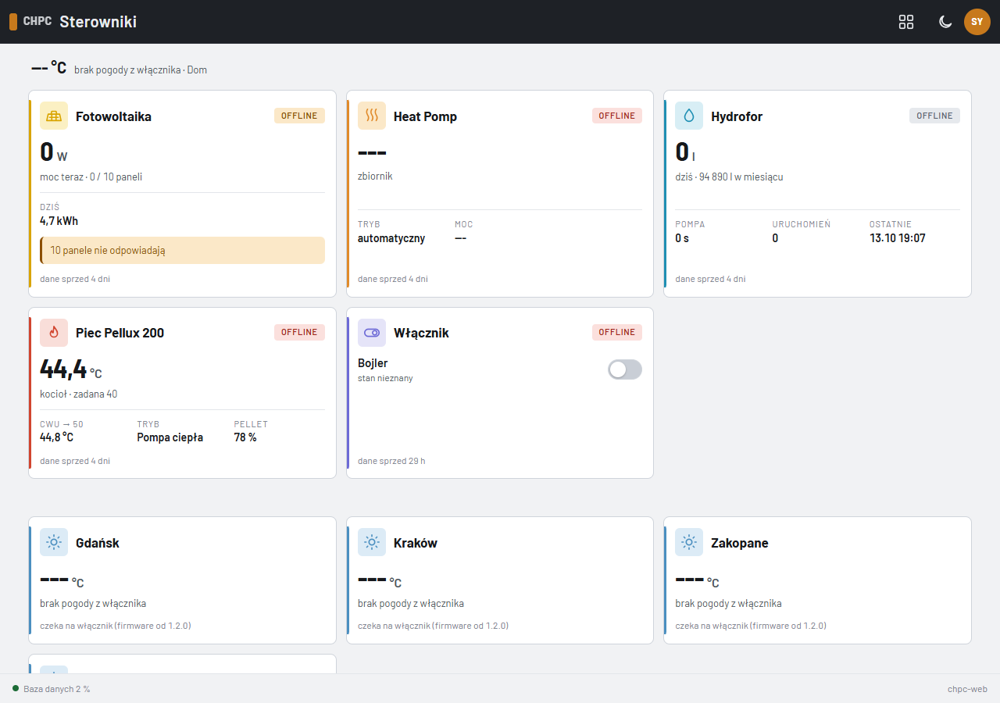

*Lista sterowników (produkcja, komputer, motyw jasny): pasek pogody domu u góry, kafelki w stałym układzie — ikona i lewa krawędź w kolorze rodzaju (słońce — fotowoltaika, fale — pompa ciepła, kropla — hydrofor, płomień — kocioł pelletowy, przełącznik — włącznik), nazwa, chip Online / Offline (Offline czerwony; hydrofor szary, bo jego sterownik ma zasilanie tylko przy pracy pompy), duża wartość z opisem, pola faktów (pompa: moc, temperatura sprężarki i wody wyjściowej; kocioł: CWU i oba mieszacze; fotowoltaika: produkcja dziś; hydrofor: pompa, uruchomienia, ostatnie), plakietka stanu („pracuje”, CO / CWU), ostrzeżenie i stopka „dane sprzed …”; włącznik pokazuje listę przekaźników z przełącznikami. Niżej kafelki pogody, na dole stopka z zajętością bazy (tylko użytkownik systemowy). Ołówek i trybik firmware pojawiają się po najechaniu na kafelek. Zrzuty w tej dokumentacji pochodzą z instalacji produkcyjnej (2026-10-18); imię, e-mail, adres, SN, Root ID, adresy IP i numery mikrofalowników są zmienione.*

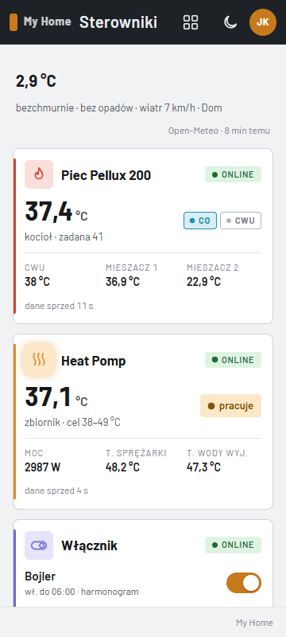

*Ta sama lista na telefonie (360 px): jedna kolumna, kafelki po kolei.*

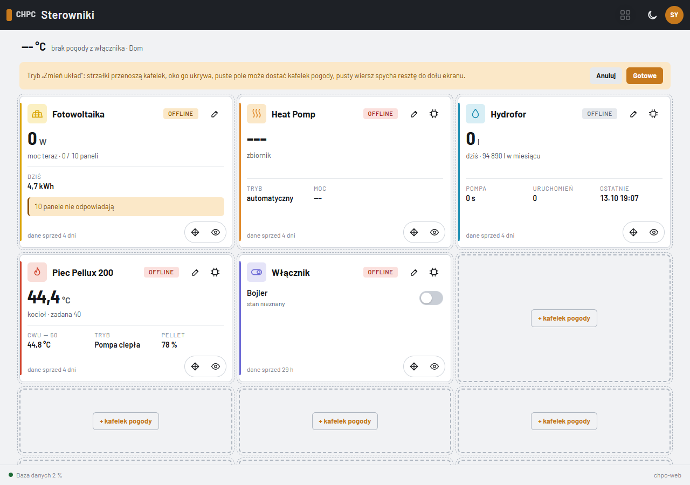

*Tryb „Zmień układ” (ikona siatki w pasku): strzałki przenoszą kafelek, oko go ukrywa, puste pole może dostać kafelek pogody, „Gotowe” zapisuje układ. Kafelki ukryte widać tylko tutaj, wyszarzone z chipem „Ukryty”.*

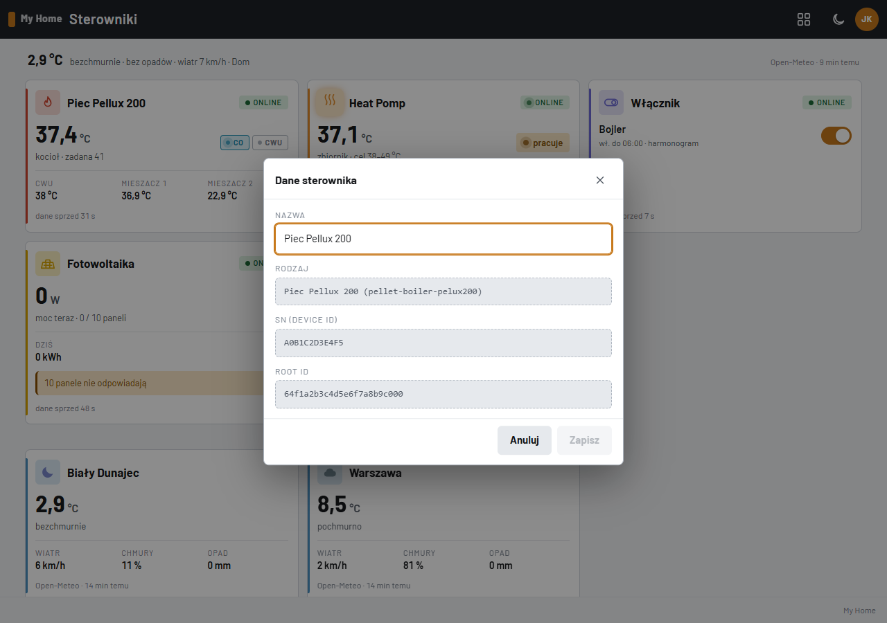

*Okno „Dane sterownika” (tu kocioł): nazwa do zmiany; rodzaj, SN (Device ID) i Root ID tylko do odczytu; rodzaje, które mają własne pola (pompa ciepła: konfiguracja ze schematem podłączenia), pokazują je niżej.*

| Strona pogody (komputer) | Strona pogody (telefon) |
|---|---|
| 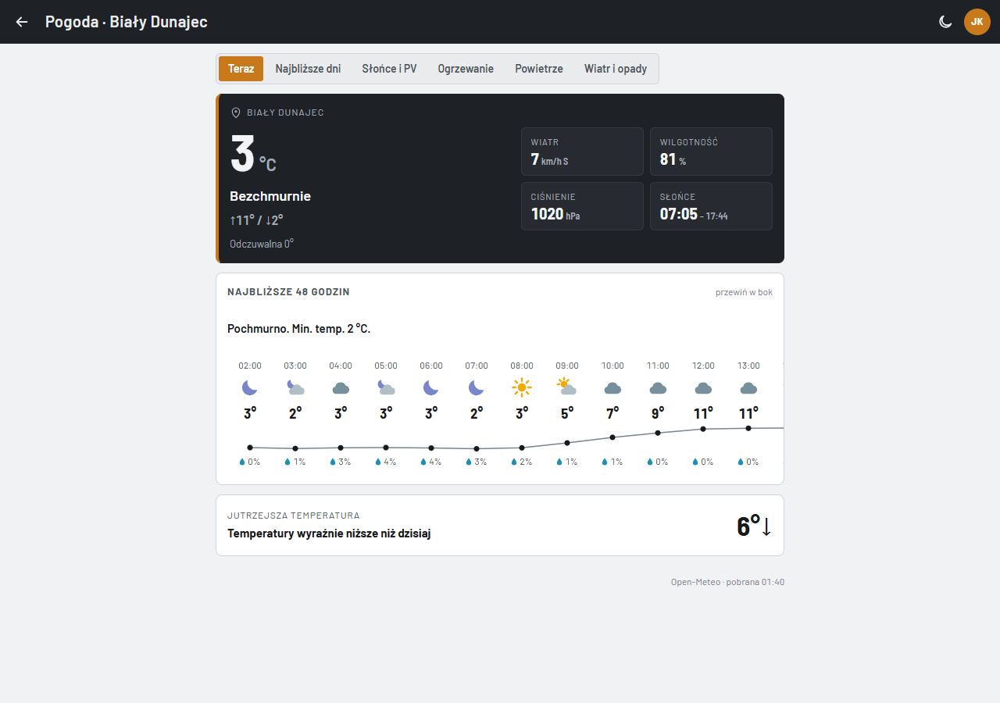 | 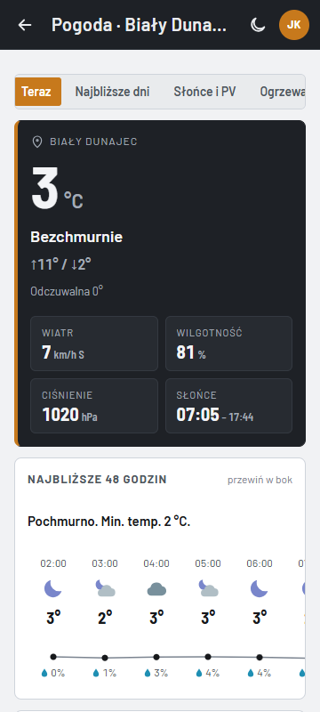 |

*Strona pogody (kliknięcie kafelka pogody): zakładki Teraz, Najbliższe dni, Słońce i PV, Ogrzewanie, Powietrze, Wiatr i opady — jak widoki sterownika: w bocznym menu na komputerze, w dolnej nawigacji z „Więcej” na telefonie. „Teraz” to karta z temperaturą, opisem nieba, maksimum i minimum dnia, temperaturą odczuwalną, wiatrem, wilgotnością, ciśnieniem i godzinami słońca, pasek najbliższych 48 godzin (ikona, temperatura, prawdopodobieństwo opadu) i jutrzejsza temperatura. Bieżące warunki pochodzą z pomiaru pobranego przez włącznik, prognozę i jakość powietrza przeglądarka pobiera wprost z Open-Meteo.*

| Telefon — pasek i dolna nawigacja | Telefon — „Więcej” |
|---|---|
| 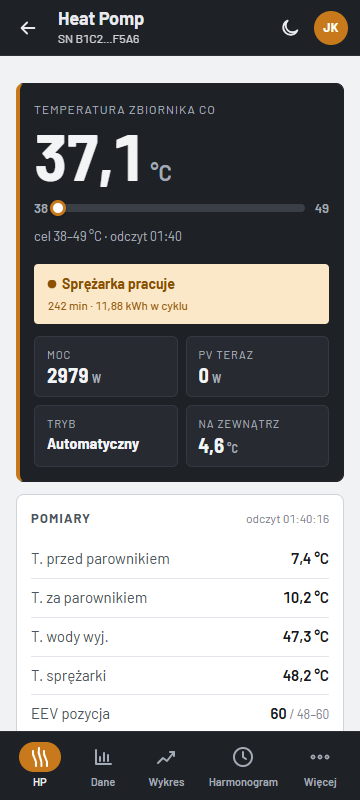 | 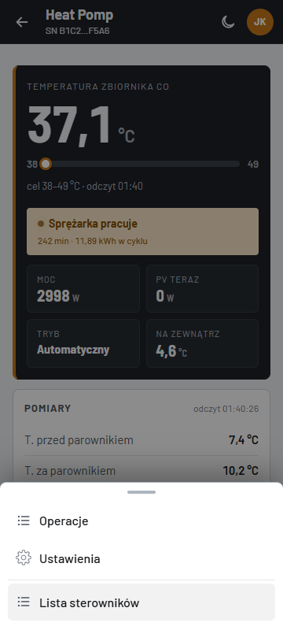 |

*Pasek sterownika: strzałka wstecz do listy, nazwa, pod nią chip Online / Offline i opis zależny od rodzaju (tryb i SN, liczba paneli, ostatnie uruchomienie, przekaźniki i firmware, regulator i interwał odczytu), ikona motywu i awatar konta. Na komputerze (od 900 px) zakładki są w bocznym menu po lewej; na telefonie dolna nawigacja pokazuje cztery pierwsze widoki i „Więcej” — arkusz z resztą widoków i „Listą sterowników”. Zakładki zależą od rodzaju: pompa ma sześć (HP, Dane, Wykres, Harmonogram, Operacje, Ustawienia), hydrofor i włącznik pięć, kocioł siedem (z Alarmami), fotowoltaika cztery.*

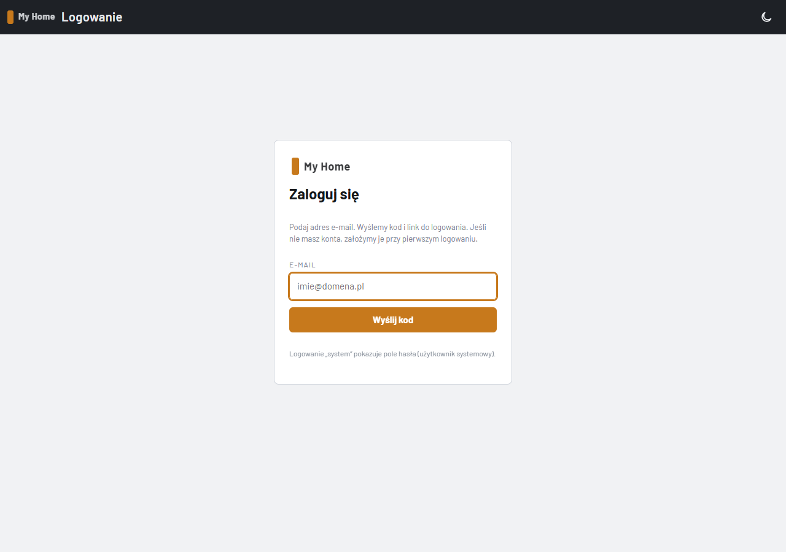

*Logowanie: karta z adresem e-mail; kod i link przychodzą mailem. Ikona motywu działa już na tym ekranie. Mail wysyła włącznik w domu (zapasowo sterownik `co`), więc dociera w kilka sekund; bez sterownika w sieci logowanie dostaje komunikat o niedostępnej poczcie, a użytkownik systemowy loguje się hasłem.*

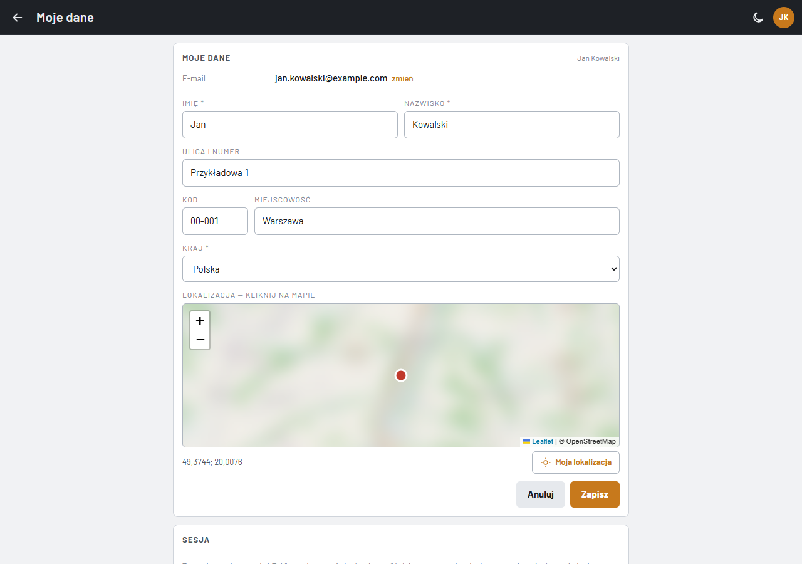

*„Moje dane” (menu konta): e-mail ze zmianą przez kod, imię i nazwisko, adres i kraj, lokalizacja wybierana na mapie albo „Moja lokalizacja” z przeglądarki (z niej jest pogoda domu i strefa czasowa kafelków). Niżej karty „Sesja” i „Usunięcie konta”.*

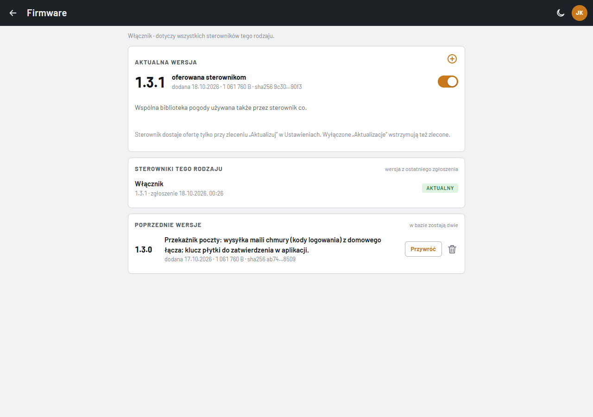

*Strona firmware rodzaju sterownika (trybik na kafelku, tylko użytkownik systemowy): karty „Aktualna wersja” (plus otwiera kartę „Dodaj wersję”), „Sterowniki tego rodzaju” z wersją z ostatniego zgłoszenia i „Poprzednie wersje”.*

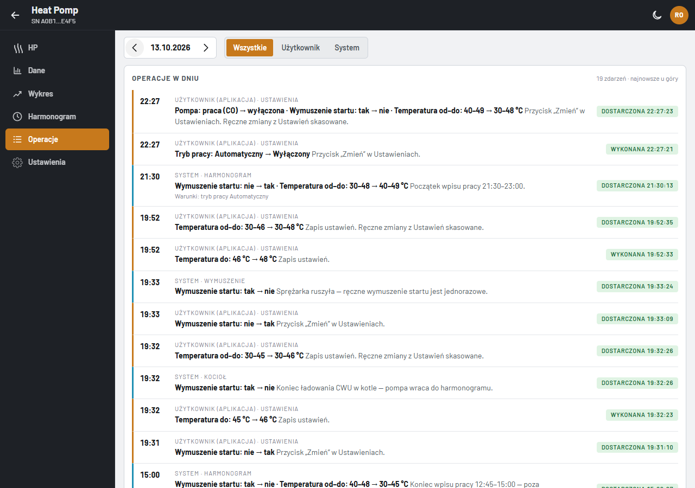

*Zakładka „Operacje”: dzień (strzałki albo kalendarz), filtr Wszystkie / Użytkownik / System i oś czasu zdarzeń: godzina, kto i skąd, co się zmieniło i chip stanu (wykonana, dostarczona, w toku, błąd). Dziennik trzyma 5 dni.*

## Typowe scenariusze

1. **Nowy sterownik.** Instalator podłącza sterownik i ustawia mu Wi-Fi. Sterownik sam zgłasza się do chmury i pojawia się na liście — bez nazwy, z samym identyfikatorem (SN). Użytkownik nadaje mu nazwę ołówkiem.
2. **Codzienna praca.** Aplikacja po otwarciu pokazuje listę kafelków z bieżącym stanem każdego sterownika (temperatura, moc, woda, przekaźniki). Kliknięcie kafelka otwiera ekrany sterownika; strzałka w pasku wraca do listy.
3. **Kilka sterowników.** Użytkownik przełącza się przez listę (strzałka wstecz albo „Więcej” na telefonie). Wybrany sterownik zostaje w przeglądarce po przeładowaniu strony, ale nowa sesja przeglądarki zaczyna znów od listy.
4. **Wymiana sterownika albo wyczyszczenie jego pamięci.** Sterownik zgłasza się ponownie z tym samym SN i dostaje ten sam rekord — historia danych zostaje.
5. **Sterownik z kilkoma rolami.** Jeden fizyczny sterownik może występować w aplikacji jako kilka urządzeń o tym samym identyfikatorze (SN), każde z własnym Root ID, menu i historią danych. Tak było 2026-10-01–02, gdy `co` obsługiwał pompę ciepła i kocioł pelletowy; od 2026-10-03 kocioł ma osobny sterownik pieca, a mechanizm ról został w aplikacji.
6. **Domownik.** Właściciel udostępnia sterownik na e-mail domownika z wybranymi zakładkami; po zalogowaniu domownik widzi kafelek sterownika i tylko te zakładki.

## Ograniczenia i ryzyka

- **Klucz API pozostaje wyłączony.** Aplikacja wymaga zalogowania (konta użytkowników), ale kontrola klucza API na serwerze jest wyłączona, a endpointy sterowników przyjmują sam SN. Root ID nie powinien trafiać do publicznych miejsc (zrzuty w tej dokumentacji mają zmyślone identyfikatory).
- **Sterownika nie da się usunąć z aplikacji.** Usunięcie wymaga zmiany w bazie danych.
- **Część danych jest w pamięci serwera** (ostatnia telemetria, operacje ręczne, dane urządzeń). Restart serwera je czyści; sterownik odtwarza je przy kolejnej wysyłce.
- **Temperatura zewnętrzna** pochodzi z jednej stacji IMGW (Zakopane) — dla instalacji w innym miejscu trzeba zmienić stację w kodzie.
- **Poczta zależy od sterownika w domu.** Serwer na darmowym planie Render nie może łączyć się z SMTP, więc maile (kody logowania, zaproszenia, potwierdzenia) wysyła włącznik, a zapasowo `co`. Gdy oba są bez sieci, logowanie kodem nie działa (komunikat „Poczta jest chwilowo niedostępna”); zostaje konto systemowe z hasłem. Klucz płytki, która ma dostać dane poczty, zatwierdza użytkownik systemowy po porównaniu odcisku ze stroną `/install` płytki.
- **Pogoda zależy od włącznika.** Bieżące warunki pobiera włącznik z domowego łącza (Render dzieli adres IP z innymi usługami i Open-Meteo odrzucało zapytania serwera); bez włącznika pasek i kafelki pogody pokazują ostatni odczyt, a potem prognozę.

## Słownik

| Pojęcie | Znaczenie |
|---|---|
| **Sterownik** | urządzenie przy instalacji, które łączy się z chmurą: `co` (pompa ciepła), sterownik hydroforu, sterownik pieca (kocioł pelletowy) albo włącznik |
| **Rodzaj sterownika** (`deviceType`) | `heat_pump`, `water-pressure-tank`, `pellet-boiler-pelux200` albo `switch`; decyduje o menu, ekranach i obsłudze danych |
| **Rola sterownika** | jedno zadanie fizycznego sterownika (np. `co` jako pompa ciepła albo jako kocioł); każda rola to osobne urządzenie w aplikacji |
| **SN** (`deviceId`) | numer seryjny sterownika — fabryczny adres MAC układu ESP32, 12 znaków szesnastkowych; wspólny dla wszystkich ról tego samego sterownika |
| **Root ID** (`rootId`) | identyfikator urządzenia (roli) w bazie danych; aplikacja i sterownik podają go przy każdym zapytaniu |
| **Zgłoszenie sterownika** | zapytanie, które sterownik wysyła przy starcie; tworzy urządzenie albo zwraca istniejące |
| **Konto** | użytkownik aplikacji: e-mail, imię i nazwisko, lokalizacja; własne sterowniki, własny układ kafelków i kafelki pogody |
| **Udostępnienie** | dostęp innego konta do sterownika z wybranymi zakładkami albo jako „Panel prosty”; właściciel może go zmienić albo cofnąć |
| **Kafelek prosty** | kafelek włącznika albo pieca na liście z dużymi przyciskami zamiast wartości (2026-10-20); dwa takie kafelki mieszczą się na ekranie telefonu bez przewijania |
| **Kafelek** | pole na liście sterowników: sterownik z bieżącym stanem albo pogoda miejscowości |
| **Strona pogody** | ekran po kliknięciu kafelka pogody: bieżące warunki, prognoza, słońce i PV, ogrzewanie, powietrze, wiatr i opady |
| **Przekaźnik poczty** | sterownik w domu (włącznik, zapasowo `co`), który wysyła maile aplikacji; dane poczty dostaje zaszyfrowane swoim kluczem i trzyma tylko w pamięci |
| **Ustawienia** (`properties`) | ustawienia sterownika zapisane w chmurze (np. temperatury pompy, czas kompresora hydroforu) |
| **Rejestr rodzajów sterowników** | miejsce w kodzie, gdzie każdy rodzaj opisuje swoje menu, ekrany i ustawienia domyślne |
| **Motyw** | wygląd jasny albo ciemny („Instrument”); bez wyboru jasny, „Jak system” bierze ustawienie urządzenia |
