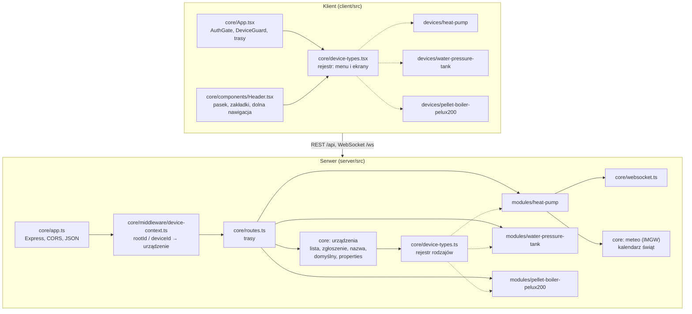
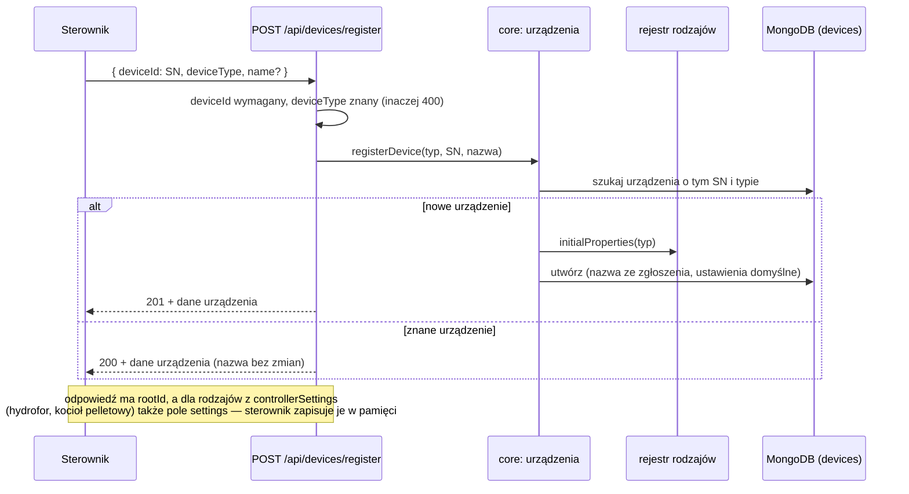
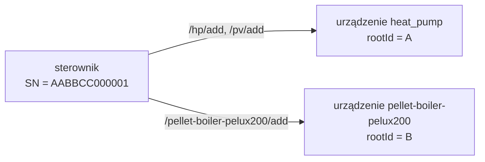
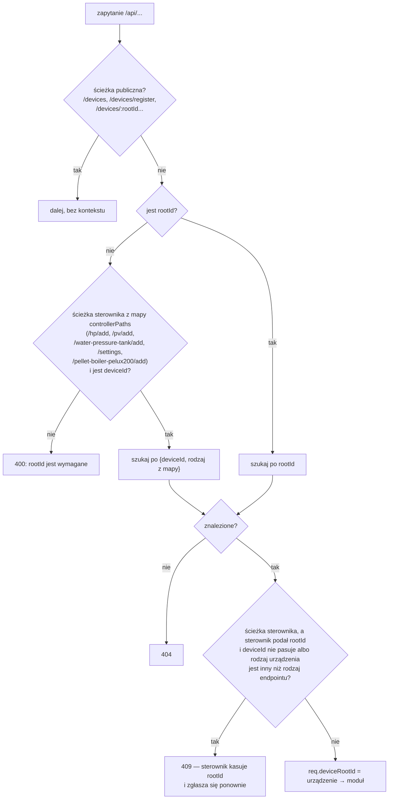
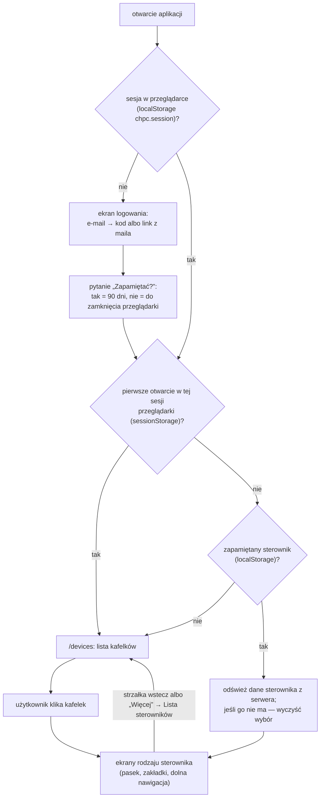
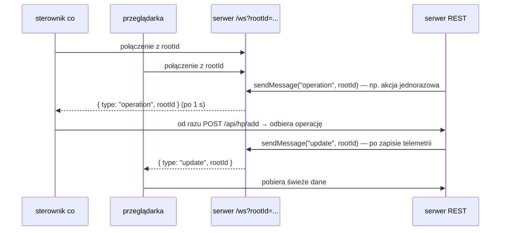

# Moduł core — zasada działania

[← Dokumentacja systemu](../../README.md) · [1. Opis biznesowy](1-opis-biznesowy.md) · **2. Zasada działania** · [3. Dokumentacja techniczna](3-dokumentacja-techniczna.md) · [English](../../en/moduly/core/2-how-it-works.md)

## Miejsce w systemie

Core łączy moduły rodzajów sterowników w jedną aplikację. Po stronie serwera przyjmuje każde zapytanie, ustala, którego sterownika dotyczy, i przekazuje je do modułu. Po stronie klienta pilnuje wybranego sterownika i buduje menu z opisów modułów.

Moduły rodzajów sterowników nie znają się nawzajem. Łączy je tylko core: trasy, rejestr i wspólny dokument urządzenia w bazie.

## Zgłoszenie sterownika

Hydrofor wysyła zgłoszenie przy każdym starcie (odbiera w nim ustawienia), a `co` przy każdym starcie, po każdej zmianie adresu IP i po odpowiedzi 409, także gdy ma już Root ID danej roli (inny `rootId` z odpowiedzi zastępuje zapisany); sterownik pieca zgłasza się przy każdym starcie. Hydrofor, `co` i sterownik pieca wysyłają w zgłoszeniu swój adres IP, który klient pokazuje w Ustawieniach. Serwer rozpoznaje urządzenie po parze (rodzaj, SN): nowe tworzy, znanemu oddaje jego rekord.

Sterownik zapisuje `rootId` w swojej pamięci (NVS; sterownik z kilkoma rolami osobno dla każdej roli). Dane może wysyłać także przed zgłoszeniem, z samym SN — serwer przyjmie je, jeśli urządzenie o tym SN i rodzaju endpointu już istnieje.

## Jeden sterownik, kilka ról

Fizyczny sterownik może mieć w aplikacji kilka urządzeń. Tak było 2026-10-01–02: `co` był pompą ciepła (`heat_pump`) i kotłem pelletowym (`pellet-boiler-pelux200`); od 2026-10-03 kocioł ma osobny sterownik pieca (`devices/pellet-boiler-pelux200`), a mechanizm ról został na serwerze. Mają ten sam `deviceId` (SN), ale inny `deviceType` i inny `rootId`; model `devices` nie ma unikalnego indeksu na `deviceId`. Nie ma więc pojęcia „urządzenia nadrzędnego”: każda rola jest zwykłym urządzeniem z własnym kontekstem, menu, danymi i ustawieniami.

Skoro sam SN nie wskazuje jednoznacznie urządzenia, serwer wybiera rolę po **ścieżce endpointu** (mapa `controllerPaths` w `device-context.ts`, niżej) i szuka po parze `{deviceId, deviceType}`. Zgłoszenie (`POST /devices/register`) szuka też po tej parze, więc ten sam SN zgłoszony z innym rodzajem tworzy drugie urządzenie.

## Kontekst urządzenia w każdym zapytaniu

Prawie każde zapytanie do `/api` musi wskazać sterownik. Robi to middleware `device-context` przed przekazaniem zapytania do modułu.

Odpowiedź 409 chroni przed sytuacją, w której sterownik ma w pamięci `rootId` z innej bazy (np. po przełączeniu serwera z lokalnego na produkcyjny) albo z innej roli (np. `rootId` pompy wysłany na endpoint kotła).

Dla zwykłych endpointów (spoza `controllerPaths`) kontekst wyznacza wyłącznie `rootId`, bez sprawdzania rodzaju urządzenia.

## Wybór sterownika w aplikacji

- Bez sesji każda ścieżka pokazuje ekran logowania (`AuthGate`); link z maila prowadzi na `/login?token=…`. Nowe konto musi najpierw uzupełnić imię, nazwisko i kraj. Sesja „zapamiętana” trwa 90 dni od zalogowania, niezapamiętana — 24 h od ostatniego użycia (znika po zamknięciu przeglądarki).
- Nowa sesja przeglądarki zaczyna zawsze od listy kafelków (`sessionStorage` `chpc.startedOnList`); sterownika domyślnego ani automatycznego wyboru nie ma.
- Wybrany sterownik jest w `localStorage` (`chpc.selectedDevice`), więc przeładowanie strony zostaje na jego ekranach. Zapamiętany sterownik, którego nie ma w bazie (np. po przełączeniu z bazy lokalnej na produkcyjną), jest usuwany z pamięci przeglądarki. Błąd sieci niczego nie usuwa.
- Sterownik udostępniony przez inne konto ma nad treścią pasek „Udostępnione przez …” i w menu tylko udostępnione zakładki. Udostępnienie „Panel prosty” (`tabs: ['simple']`) nie daje żadnej zakładki: osoba widzi na liście sam kafelek prosty (włącznik: Włącz / Wyłącz / harmonogram, piec: Włącz piec / Wyłącz piec / CWU) i może tylko wysyłać te polecenia (`PUT /switch/mode`, `POST /pellet-boiler-pelux200/simple`). Właściciel włącza kafelek prosty na własnej liście przełącznikiem w oknie „Dane sterownika” (`users.simpleTiles`).

## Menu i ekrany z rejestru

Każdy rodzaj sterownika podaje w swoim pliku `device-type` listę ekranów (ścieżka, nazwa, ikona, strona). Aplikacja:

1. tworzy trasy dla wszystkich ścieżek wszystkich rodzajów;
2. dla wybranej ścieżki pokazuje ekran rodzaju aktywnego sterownika;
3. jeśli ten rodzaj nie ma takiej ścieżki (np. hydrofor i `/schedules`), przekierowuje na stronę główną;
4. zakładki w pasku rysuje z ekranów aktywnego rodzaju: na komputerze (od 900 px) jako boczne menu po lewej, na telefonie jako dolną nawigację z czterema pierwszymi widokami i „Więcej” (arkusz z resztą widoków i „Listą sterowników”).

Po zmianie sterownika ekran jest tworzony od nowa, więc nie zostają w nim dane poprzedniego sterownika. Zakładka „Operacje” (dziennik operacji) jest wspólna i rodzaj tylko dodaje ją do swojej listy; strony poza kontekstem sterownika (`/devices`, `/account`, `/firmware/:deviceType`) mają własny pasek bez zakładek.

Wygląd „Instrument” (makiety w `makiety/`, 2026-10-16): wszystkie ekrany są zbudowane z tych samych elementów — karta z nagłówkiem, karta „hero” z dużą wartością i polami KPI na podglądzie, pasek filtrów (nawigacja po dacie ‹ ›, przełącznik segmentowy, przycisk CSV) nad tabelą albo wykresem, kafelki statystyk, lista wpisów harmonogramu z oznaczeniem „działa teraz”, dwie kolumny w Ustawieniach (formularz po lewej, karty „Sterownik” i „Udostępnianie” po prawej), okna dialogowe `.modal`. Kolory pochodzą wyłącznie z tokenów motywu (`theme.css`), więc ten sam układ działa w motywie jasnym i ciemnym.

Serwer ma analogiczny rejestr: każdy rodzaj podaje ustawienia nowego urządzenia i ustawienia odsyłane przy zgłoszeniu (hydrofor: czas kompresora; kocioł pelletowy: `poll_interval_seconds`).

## WebSocket

WebSocket niczego nie przenosi poza sygnałem „zajrzyj po dane”. Operacje zawsze trafiają do sterownika w odpowiedzi na jego zapytanie HTTP. Połączenie bez `rootId` serwer zamyka.

## Usługi wspólne

- **Temperatura zewnętrzna.** Przy starcie i co 10 minut serwer pobiera pomiar ze stacji synoptycznej IMGW (Zakopane). Wartość jest dopisywana do rekordów telemetrii pompy (`t_out`) i odsyłana sterownikowi `co`, który pokazuje ją na ekranie.
- **Kalendarz.** Wszystkie daty użytkownika są w strefie `Europe/Warsaw`. Kalendarz zna polskie święta stałe i ruchome (także Wigilię) i rozstrzyga, czy dzień jest roboczy — korzysta z tego scheduler harmonogramów pompy.
- **Pogoda.** Serwer sam nie pyta Open-Meteo (Render dzieli adres IP z innymi usługami i zapytania były odrzucane). W odpowiedzi na każde zgłoszenie stanu włącznik dostaje listę miejsc (`weather_queries`: dom i kafelki pogody wszystkich kont, najwyżej 8), pobiera warunki co 15 min na miejsce i odsyła je w kolejnym zgłoszeniu; serwer trzyma je w pamięci po id kafelka (`meteo.service`), odczyt starszy niż 45 min pomija. `GET /temperature` daje temperaturę domu (czujnik zewnętrzny kotła do 15 min od pomiaru, bez niego prognoza) i pogodę domu — z niej korzystają pasek nad listą, kafelek „Dom” i nagłówek „Teraz” strony pogody (od 2026-10-21), bo model z siatką 2 km mylił się nocą o 3–4 °C; `GET /weather-tiles` kafelki z pogodą. Prognozę na stronie pogody przeglądarka pobiera wprost z Open-Meteo.
- **Poczta przez sterowniki** (`MAIL_RELAY=1`). `sendMail` składa wiadomość MIME, odkłada ją w kolejce `mail_outbox` i budzi sterowniki komunikatem WebSocket `{type:"mail"}`. Wysyła włącznik; `co` przejmuje mail, gdy włącznik nie odebrał go w 20 s, zgłosił błąd albo nie odpowiedział w 60 s; najwyżej 3 próby, mail ważny 15 min. Płytka ma własną parę kluczy P-256 (klucz publiczny w zgłoszeniu `mailKey`); dane SMTP i każdy mail są szyfrowane jej kluczem (ECDH + AES-256-GCM) i trzymane tylko w pamięci płytki. Nowy klucz czeka na zatwierdzenie w aplikacji (karta „Sterownik”, wiersz „Poczta”, użytkownik systemowy). Bez sterownika pytającego o maile w ostatnich 150 s logowanie, zmiana e-maila i usunięcie konta dostają 503 jeszcze przed utworzeniem kodu.

- **Powiadomienia Web Push** (`push.service.ts`, biblioteka `web-push`, klucze VAPID w środowisku). Przeglądarka rejestruje service worker `sw.js` i subskrypcję PushManager (`POST /push/subscriptions`); reguły konta (`users.notifications`: zdarzenia dla sterownika, cisza nocna) zapisuje `PUT /push/rules`. Moduły zgłaszają zdarzenia `notify(rootId, event, {body, url})` tam, gdzie zapisują stan ze sterownika: zmiana `HPS` i nowy `error_code` pompy, zmiana stanu przekaźnika, stan z płomieniem i alarm kotła, nowe uruchomienie hydroforu; offline / online liczy wartownik co minutę z chipu kafelków (`push-watchdog.service.ts`, pierwszy przebieg tylko zapamiętuje). Odbiorca musi mieć regułę i nadal dostęp do sterownika; to samo zdarzenie nie częściej niż co 60 s na osobę; w ciszy nocnej tylko zdarzenia pilne. Subskrypcja odrzucona przez usługę push (404 / 410) jest kasowana. `notify` nie rzuca wyjątków.

## Start serwera

1. Wczytanie zmiennych środowiskowych; bez `MONGODB_URI` serwer kończy start błędem.
2. Połączenie z MongoDB.
3. Start schedulera pompy ciepła (przebieg od razu, potem co minutę).
4. Czyszczenie szczegółów paneli PV starszych niż 90 dni (od razu i co 24 h).
5. Pobranie temperatury IMGW i odświeżanie co 10 minut.
6. Nasłuch HTTP i WebSocket na porcie `PORT`.
