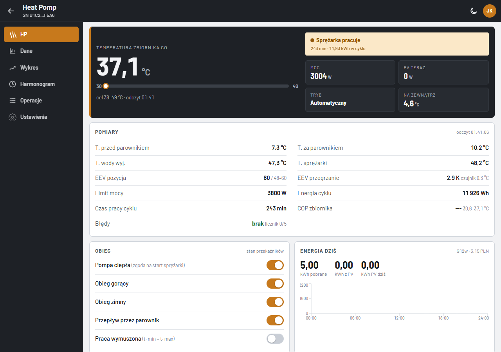
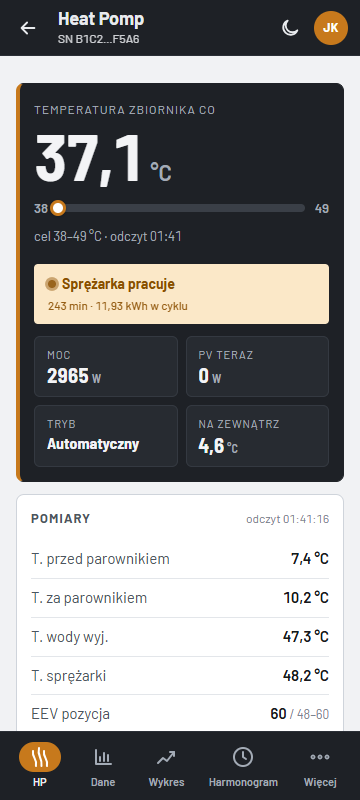
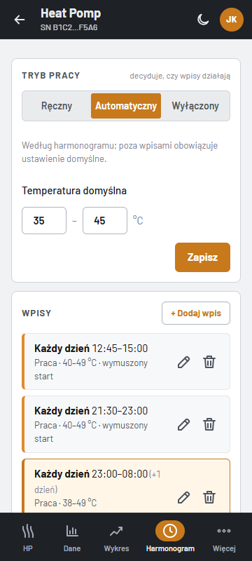
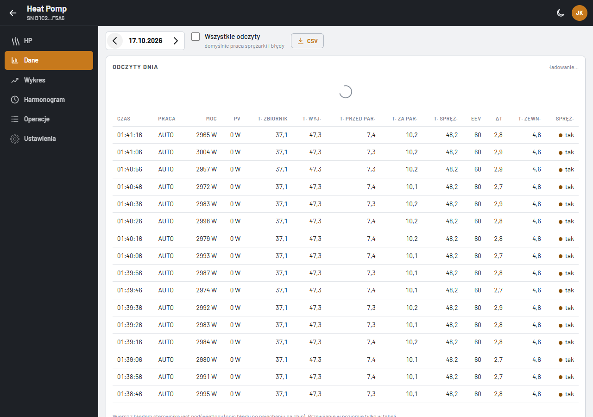
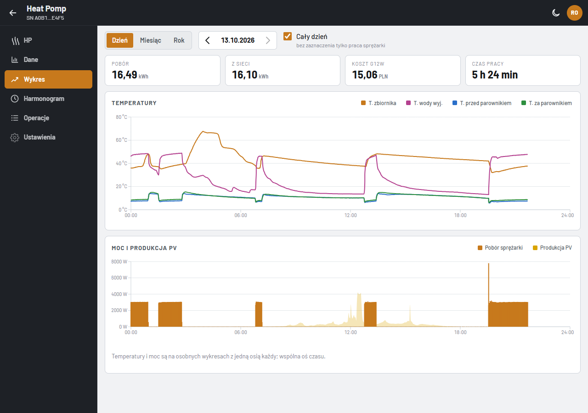
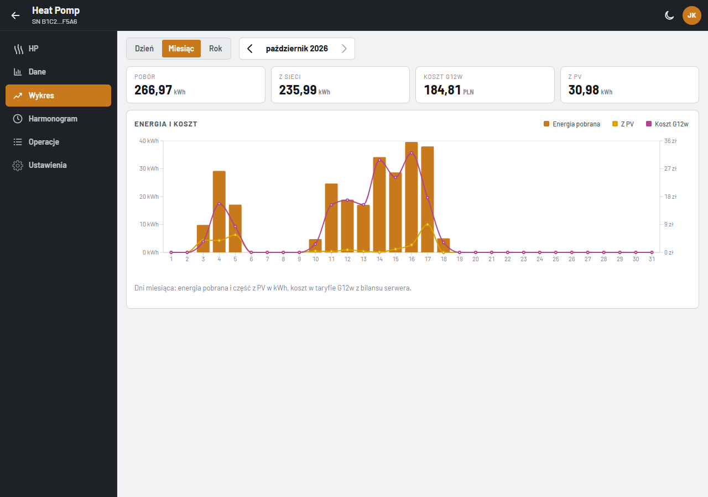
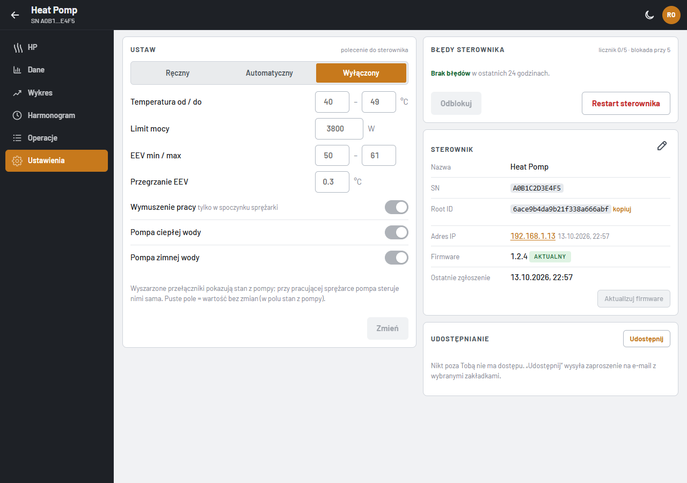
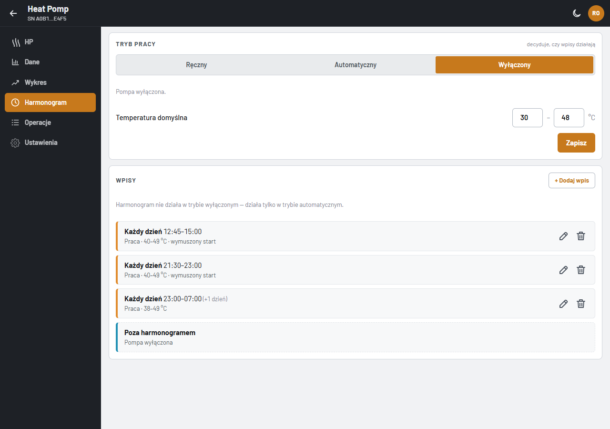

# Moduł heat-pump — opis biznesowy

[← Dokumentacja systemu](../../README.md) · **1. Opis biznesowy** · [2. Zasada działania](2-zasada-dzialania.md) · [3. Dokumentacja techniczna](3-dokumentacja-techniczna.md) · [English](../../en/moduly/heat-pump/1-business-description.md)

## Po co jest ten moduł

Moduł obsługuje w aplikacji **pompę ciepła** sterowaną przez sterownik CHPC, połączoną z chmurą przez sterownik `co`. Pozwala z telefonu albo komputera:

- zdecydować, **co pompa ma grzać i kiedy**: centralne ogrzewanie (CO), ciepłą wodę użytkową (CWU) albo nic;
- ustawić **temperatury** i **harmonogramy** (godziny, dni robocze i wolne z polskimi świętami, konkretne daty, przerwy);
- wydać **polecenie ręczne**: wymuszenie startu, pompy obiegowe, zawór rozprężny (EEV), limit mocy;
- widzieć **stan pompy na żywo**, **historię** pomiarów, **wykresy** energii i temperatur oraz **koszt energii** w taryfie G12w;
- widzieć **błędy sterownika pompy**, odblokować go i zrestartować zdalnie;
- śledzić **produkcję fotowoltaiki**, bo nadwyżkę PV opłaca się zużyć na grzanie.

Serwer sam, co minutę, wylicza z harmonogramów, co pompa ma robić. Aplikacja nie musi być otwarta.

## Dla kogo

**Właściciel domu** z pompą ciepła CHPC i sterownikiem `co`; sterownik można udostępnić domownikom z wybranymi zakładkami (konta użytkowników, [moduł core](../core/1-opis-biznesowy.md)).

## Tryby pracy

| Tryb | W aplikacji | Co robi pompa |
|---|---|---|
| `A` | **Automatyczny** | działają wpisy harmonogramu (praca i przerwy); poza nimi ustawienie domyślne |
| `CWU` | dawna wartość, w aplikacji pokazywana jak **Automatyczny** | jak `A` (do 2026-10-05 osobne harmonogramy ciepłej wody; dziś to, co pompa grzeje, wynika z podłączenia CWU / CO w oknie „Dane sterownika”) |
| `M` | **Ręczny** | harmonogramy nie działają, obowiązuje ustawienie domyślne; o północy tryb wraca na `A` |
| `OFF` | **Wyłączony** | sprężarka nie startuje |

## Ekrany

Zrzuty pochodzą z lokalnej bazy demonstracyjnej z danymi z 13.10.2026 (wygląd „Instrument”, motyw jasny); sterownik był wtedy offline, dlatego widok główny pokazuje pasek „Offline od …” i puste wartości z pompy.

*Widok główny (HP): na górze pasek „Offline od …” z przyczyną, gdy pompa nie przysyła danych. Karta hero: temperatura w środku zbiornika na pasku zakresu od–do, stan sprężarki, tryb pracy i czas odczytu oraz cztery pola: moc, PV teraz, COP i temperatura na zewnątrz. Niżej karty „Pomiary” (temperatury, EEV, limit mocy, energia i czas cyklu, COP zbiornika, błędy), „Obieg” (przełączniki ze stanem przekaźników z telemetrii: zgoda na start sprężarki, obieg gorący i zimny, przepływ) i „Energia dziś” (zużycie, część z PV, koszt G12w, mini wykres mocy). Odświeża się sam po każdej wysyłce sterownika.*

| Telefon | Harmonogram na telefonie |
|---|---|
|  |  |

*Na telefonie (360 px) karty idą jedna pod drugą, a dolna nawigacja pokazuje HP, Dane, Wykres, Harmonogram i „Więcej” (Operacje, Ustawienia, lista sterowników).*

*Dane: pasek filtrów (dzień z danymi strzałkami ‹ › albo z listy po kliknięciu daty, „Wszystkie odczyty” — domyślnie tylko praca sprężarki i błędy, przycisk CSV) i karta „Odczyty dnia” z liczbą odczytów i czasem pracy sprężarki; wiersz z błędem sterownika jest podświetlony i ma chip z kodem. Tabela przewija się w poziomie we własnym kontenerze.*

*Wykres dnia: przełącznik Dzień / Miesiąc / Rok, nawigacja po dacie i „Cały dzień” (bez zaznaczenia tylko praca sprężarki); kafelki pobór, z sieci, koszt G12w i czas pracy; dwa wykresy z jedną osią każdy — temperatury (zbiornik, woda wychodząca, przed i za parownikiem) oraz pobór sprężarki z produkcją PV; legenda w nagłówku karty przełącza serie.*

*Wykres miesiąca: energia pobrana w kolejnych dniach, część z PV i koszt w taryfie G12w (z bilansu serwera); kafelki pobór, z sieci, koszt i z PV. Widok roku pokazuje to samo w miesiącach.*

*Ustawienia (dwie kolumny): po lewej karta „Ustaw” — polecenie do sterownika: tryb Ręczny / Automatyczny / Wyłączony, temperatura od–do, limit mocy, EEV min / max, przegrzanie EEV, przełączniki wymuszenia pracy i pomp obiegowych (wyszarzone pokazują stan z pompy, gdy pompa steruje nimi sama), przycisk „Zmień”. Po prawej karty „Błędy sterownika” (ostatni błąd, licznik, „Odblokuj” i „Restart sterownika”), „Sterownik” (nazwa, SN, Root ID, adres IP, firmware ze stanem, „Aktualizuj firmware”; ołówek otwiera okno „Dane sterownika”) i „Udostępnianie”.*

*Harmonogram: karta „Tryb pracy” (Ręczny / Automatyczny / Wyłączony — decyduje, czy wpisy działają) z temperaturą domyślną od–do i „Zapisz”; karta „Wpisy” z listą (dzień, godziny, „(+1 dzień)” przy oknie przez północ, praca z temperaturami i wymuszonym startem albo przerwa), ołówkiem i koszem przy każdym wpisie, „+ Dodaj wpis” i pozycją „Poza harmonogramem”. Wpis, który działa teraz, jest podświetlony ze znacznikiem „działa teraz”. Wpis dodaje i zmienia się w oknie „Wpis harmonogramu”.*

## Typowe scenariusze

1. **Zima, tania taryfa nocna.** Tryb „Automatyczny”, wpisy pracy 21:30–5:30 (noc G12w) i 12:30–15:00; poza nimi ustawienie domyślne.
2. **Lato.** Tryb „Automatyczny”, wpisy pracy w godzinach produkcji PV z wymuszonym startem.
3. **Wyjazd.** Tryb `OFF` albo przerwa `off` na konkretne daty.
4. **Awaria.** W widoku głównym pojawia się czerwony dzwonek, w Ustawieniach opis błędu i data. Po pięciu błędach sterownik pompy się blokuje — „Odblokuj” zdejmuje blokadę, „Restart sterownika” uruchamia go ponownie.
5. **Kontrola kosztów.** Wykres miesiąca pokazuje zużycie i koszt; porównanie z produkcją PV pokazuje, ile energii pochodziło z fotowoltaiki.

## Ograniczenia

- **Brak walidacji zakresów w aplikacji.** Wartość spoza zakresu zostaje „ustawiona” w aplikacji, ale sterownik `co` albo pompa ją odrzuca. To, czego pompa naprawdę używa, widać w danych (limit mocy, EEV, temperatury).
- **Zwykłe polecenia docierają do pompy po 10–30 s** (przy najbliższej wysyłce sterownika); natychmiast działają tylko „Odblokuj” i „Restart” — i tylko wtedy, gdy `co` jest w trybie CLOUD.
- **Polecenia ręczne są w pamięci serwera** — restart serwera je kasuje; wygasają też, gdy kończy się harmonogram.
- **Czas błędu jest przybliżony** (do 10–30 s), bo pompa nie ma zegara.
- **Koszt energii to szacunek** według taryfy G12w wpisanej w kod.
- **Pompa ma jeden czujnik w zbiorniku** — „T” w widoku głównym to temperatura środka zbiornika, a nie temperatura zadana.

## Słownik

| Pojęcie | Znaczenie |
|---|---|
| **CO** | centralne ogrzewanie |
| **CWU** | ciepła woda użytkowa |
| **CHPC** | sterownik pompy ciepła (Arduino Pro Mini): sprężarka, pompy obiegowe, zawór EEV, zabezpieczenia |
| **co** | sterownik ESP32 między pompą, fotowoltaiką i chmurą |
| **Telemetria** | stan pompy wysyłany przez `co` co 10 s (sprężarka pracuje) albo 30 s (postój) |
| **Operacja** | to, co pompa ma robić (tryb, temperatury, wymuszenie…); serwer odsyła ją w odpowiedzi na telemetrię |
| **Harmonogram** | przedział godzin w wybrane dni, w którym obowiązuje rodzaj pracy `co` / `cwu` albo przerwa `off` |
| **Ustawienie domyślne** | tryb i temperatury obowiązujące poza harmonogramami |
| **Wymuszenie** (`force`) | start sprężarki bez czekania na spadek temperatury; pompa przyjmuje je tylko w postoju i kasuje przy zatrzymaniu |
| **HPS** | stan sprężarki (pracuje / postój) |
| **EEV** | elektroniczny zawór rozprężny; „EEV temp.” to zadane przegrzanie |
| **COP** | współczynnik efektywności: ciepło oddane / energia pobrana (szacunek dla zbiornika 300 l) |
| **G12w** | taryfa dwustrefowa z tańszą nocą, weekendem i częścią dnia |
| **PV** | fotowoltaika; odczyt z mikrofalowników Hoymiles (DTU) |
