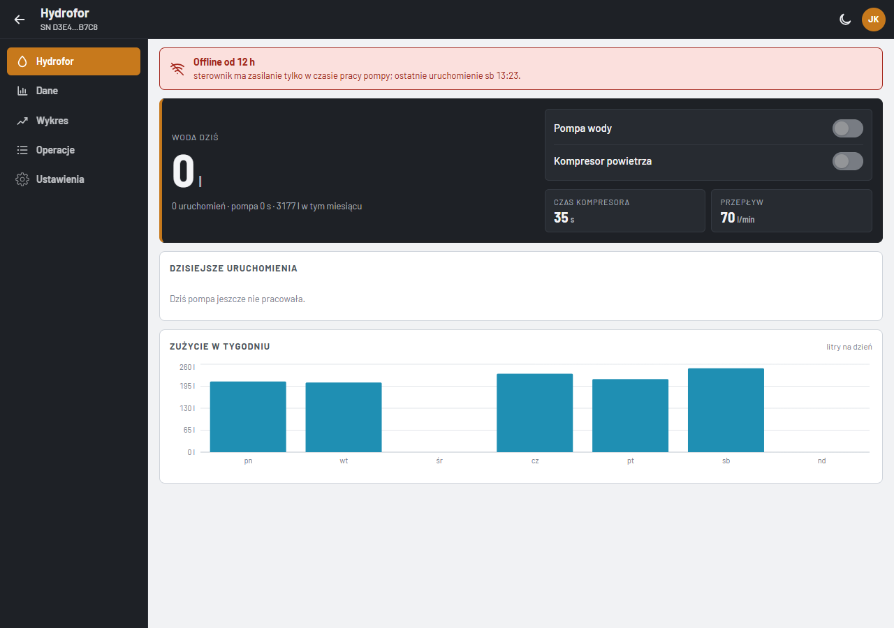
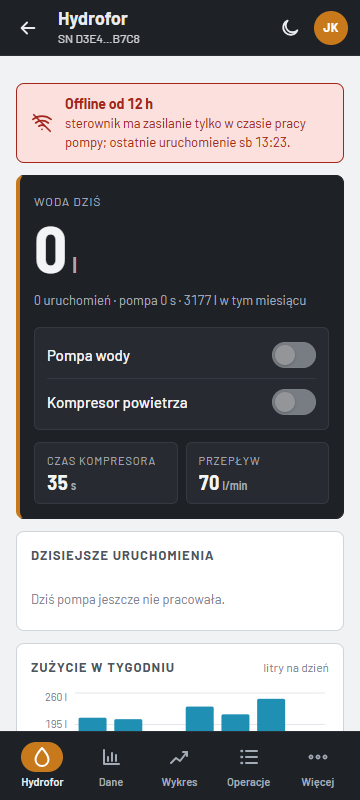
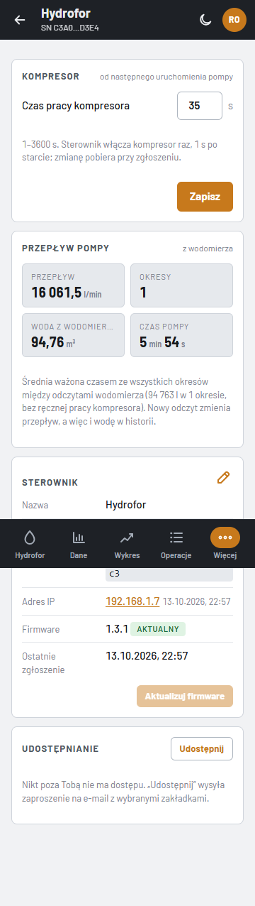
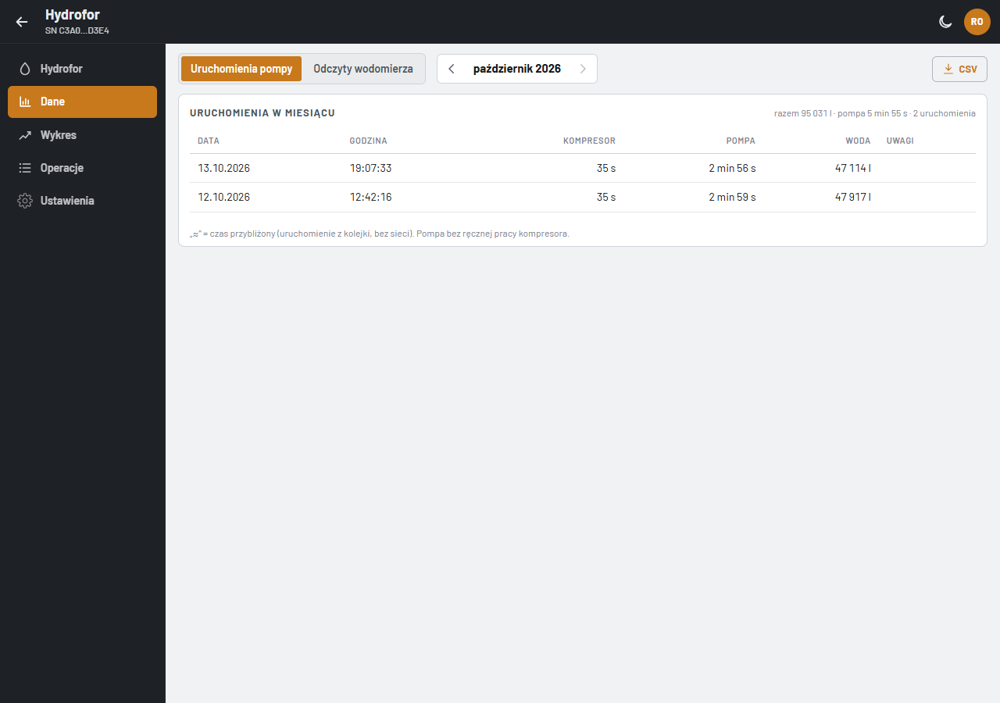
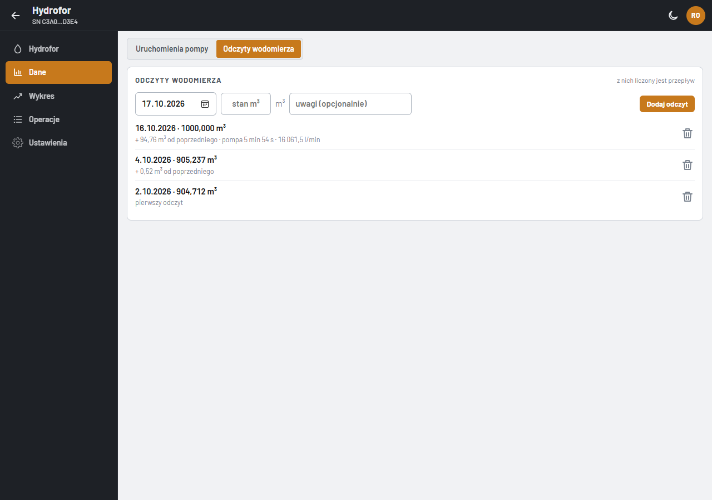
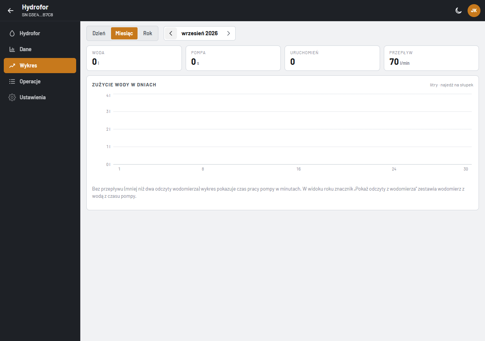
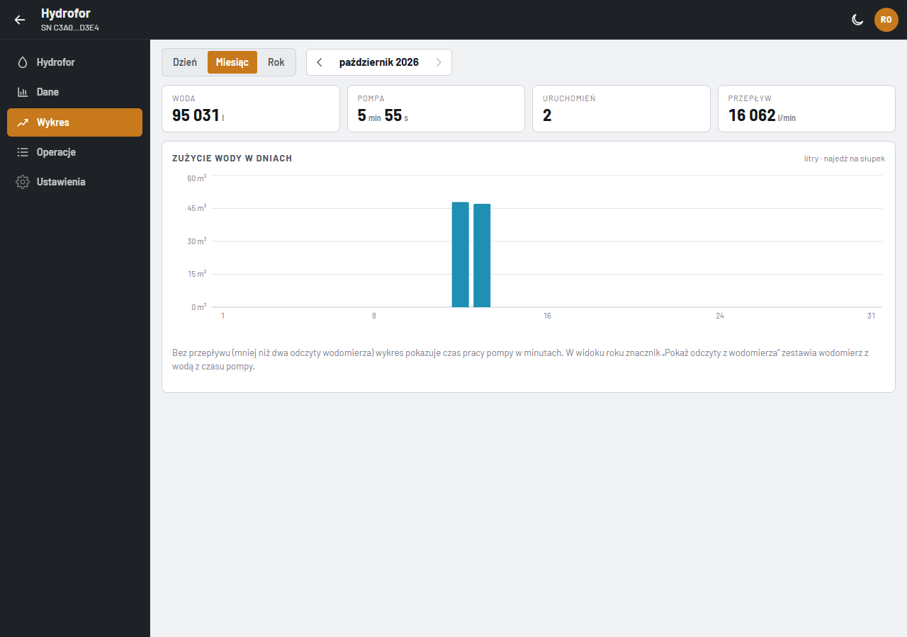
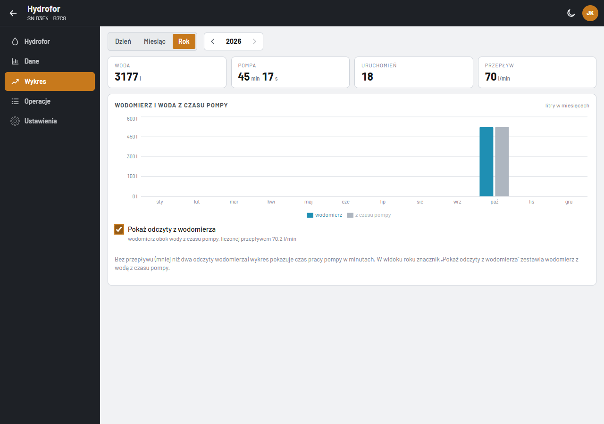
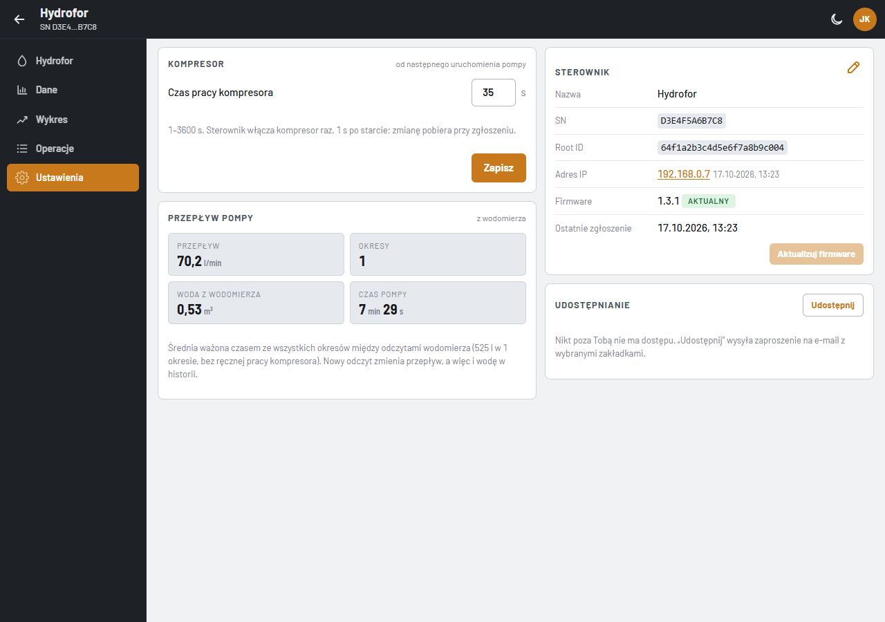

# Moduł water-pressure-tank — opis biznesowy

[← Dokumentacja systemu](../../README.md) · **1. Opis biznesowy** · [2. Zasada działania](2-zasada-dzialania.md) · [3. Dokumentacja techniczna](3-dokumentacja-techniczna.md) · [English](../../en/moduly/water-pressure-tank/1-business-description.md)

## Po co jest ten moduł

Moduł obsługuje w aplikacji **hydrofor**: domową instalację wody ze studni, w której pompa napełnia zbiorniki ciśnieniowe, a presostat włącza ją przy spadku ciśnienia i wyłącza po jego odbudowie. W zbiorniku z poduszką powietrzną powietrze stopniowo rozpuszcza się w wodzie, dlatego przy każdym starcie pompy sterownik hydroforu włącza na chwilę **kompresor**, który uzupełnia powietrze.

Moduł pozwala:

- **ustawić czas pracy kompresora**;
- **widzieć każde uruchomienie pompy**: kiedy i jak długo pracowała pompa i kompresor;
- **liczyć zużycie wody** bez wodomierza elektronicznego: z czasu pracy pompy i jej przepływu, który aplikacja wylicza z ręcznych odczytów wodomierza;
- **porównać wodę z czasu pompy z wodomierzem** w kolejnych miesiącach.

## Dla kogo

**Właściciel domu** z hydroforem i sterownikiem hydroforu (ESP32). Sterownik ma zasilanie tylko wtedy, gdy pracuje pompa, więc nie trzeba go obsługiwać.

## Ekrany

Zrzuty pochodzą z lokalnej bazy demonstracyjnej (dwa uruchomienia z 12–13.10.2026 i wygenerowane odczyty wodomierza; wygląd „Instrument”, motyw jasny); dane są przykładowe, stąd nierealny przepływ.

*Hydrofor: na górze pasek „Offline od …” z przyczyną (sterownik ma zasilanie tylko w czasie pracy pompy). Karta hero „Woda dziś” z liczbą uruchomień, czasem pompy i wodą w tym miesiącu, przełącznikami „Pompa wody” i „Kompresor powietrza” (stan z bieżącego uruchomienia) oraz polami „Czas kompresora” i „Przepływ”. Niżej karta „Dzisiejsze uruchomienia” (kolumny Kompresor, Pompa np. „4 min 10 s” bez ręcznej pracy kompresora, Woda; uruchomienie w toku jest wyróżnione) i karta „Zużycie w tygodniu” ze słupkami na dzień. Uruchomienia odświeżają się co 5 s.*

| Telefon | Ustawienia na telefonie |
|---|---|
|  |  |

*Na telefonie (360 px) karty idą jedna pod drugą, a dolna nawigacja pokazuje Hydrofor, Dane, Wykres, Operacje i „Więcej” (Ustawienia, lista sterowników).*

| Dane — uruchomienia pompy | Dane — odczyty wodomierza |
|---|---|
|  |  |

*Dane: pasek filtrów z przełącznikiem „Uruchomienia pompy” / „Odczyty wodomierza”, nawigacją po miesiącu i CSV. Karta „Uruchomienia w miesiącu” (data, godzina, kompresor, pompa w minutach i sekundach, woda, uwagi; w nagłówku „razem X l · pompa Y · N uruchomień”; „≈” i chip „z kolejki” oznaczają czas przybliżony, czyli uruchomienie wysłane później, bo zabrakło sieci). Karta „Odczyty wodomierza”: formularz (data, stan w m³, uwagi) i lista od najnowszego z przyrostem, czasem pompy i przepływem okresu; kosz usuwa odczyt.*

| Wykres — dzień | Wykres — miesiąc |
|---|---|
|  |  |

*Wykres: przełącznik Dzień / Miesiąc / Rok z nawigacją po dacie, kafelki woda, pompa, uruchomień i przepływ oraz karta ze słupkami wody w godzinach, dniach albo miesiącach (oś w m³ przy dużych wartościach). Dopóki nie ma przepływu, słupki pokazują czas pracy pompy w minutach, a pod wykresem jest podpowiedź o dwóch odczytach wodomierza.*

*Wykres roku z włączonym „Pokaż odczyty z wodomierza”: w każdym miesiącu zużycie z wodomierza obok wody „z czasu pompy”, a pod znacznikiem przepływ, którym ją policzono.*

*Ustawienia (dwie kolumny): po lewej karta „Kompresor” (czas pracy kompresora, działa od następnego uruchomienia pompy) i karta „Przepływ pompy” (przepływ, liczba okresów, woda z wodomierza i czas pompy, z których go policzono, albo instrukcja: dwa odczyty wodomierza); po prawej karta „Sterownik” (nazwa, SN, Root ID, adres IP, firmware ze stanem, „Aktualizuj firmware”; ołówek otwiera okno „Dane sterownika”) i karta „Udostępnianie”.*

## Pierwsze uruchomienie

1. Sterownik po pierwszym starcie sam zgłasza się do chmury i dostaje ustawienie domyślne: kompresor 30 s.
2. Dodać **odczyty wodomierza** (Dane → Odczyty wodomierza): co najmniej dwa, między którymi pracowała pompa, najlepiej co kilka tygodni. Od drugiego odczytu aplikacja zna przepływ pompy i pokazuje wodę także w uruchomieniach z przeszłości.
3. Opcjonalnie udostępnić hydrofor domownikom (Ustawienia → „Udostępnianie”).

Zmiana czasu kompresora w aplikacji dociera do sterownika **przy następnym uruchomieniu pompy** (sterownik ma zasilanie tylko w czasie pracy pompy). Czas kompresora można też zmienić na stronie sterownika `/install`; trafi wtedy do chmury.

## Ograniczenia

- **Woda jest przybliżona.** Zakłada stały przepływ pompy. Przepływ to średnia ze wszystkich okresów między odczytami wodomierza, ważona czasem pracy pompy.
- **Przed dwoma odczytami wodomierza wody nie ma** (w aplikacji „---”). Czas pracy pompy jest widoczny od początku.
- **Każdy nowy odczyt wodomierza zmienia przepływ**, a więc i wodę w całej historii, bo woda nie jest zapisywana, tylko liczona przy odczycie.
- **Ręczna praca kompresora** („Włącz” na stronie sterownika) jest odejmowana od czasu pracy pompy, bo w tym czasie pompa nie tłoczy wody do odbioru.
- **Bez sieci** uruchomienie trafia do chmury przy następnym starcie, z czasem przybliżonym.
- **Czas uruchomienia** jest dokładny do ok. 1 s (sterownik nie ma zegara; czas liczy serwer).

## Słownik

| Pojęcie | Znaczenie |
|---|---|
| **Hydrofor** | pompa + zbiorniki ciśnieniowe + presostat |
| **Presostat** | włącznik ciśnieniowy: włącza pompę przy progu dolnym, wyłącza przy górnym |
| **Zbiornik z poduszką powietrzną** | zbiornik (np. ocynkowany), w którym woda styka się z powietrzem; powietrza ubywa, stąd kompresor |
| **Uruchomienie** | jeden cykl pompy od włączenia do wyłączenia przez presostat |
| **Czas pompy** | czas pracy pompy w uruchomieniu bez ręcznej pracy kompresora |
| **Przepływ pompy** | litry na minutę: suma wody z wodomierza podzielona przez sumę czasu pompy z okresów między odczytami |
| **Wodomierz** | licznik wody; odczyty wpisuje użytkownik |
